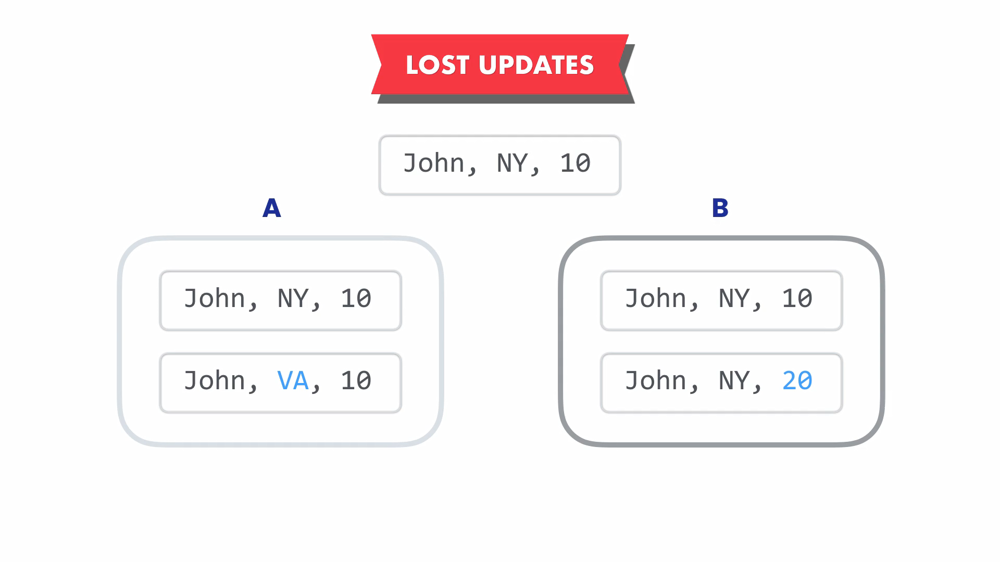
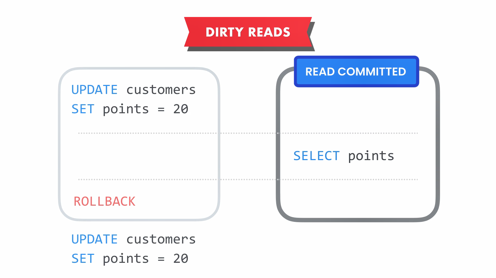
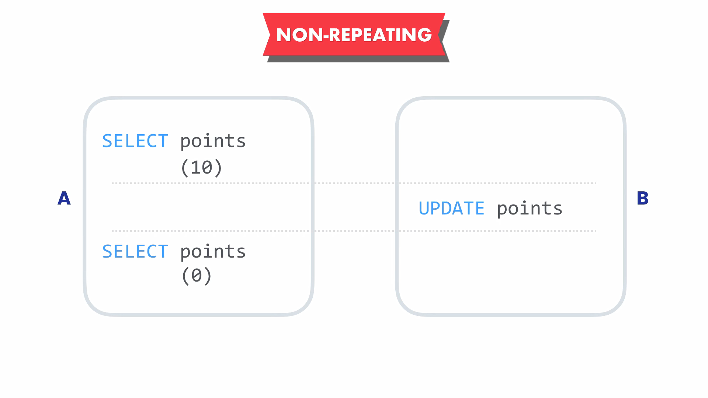
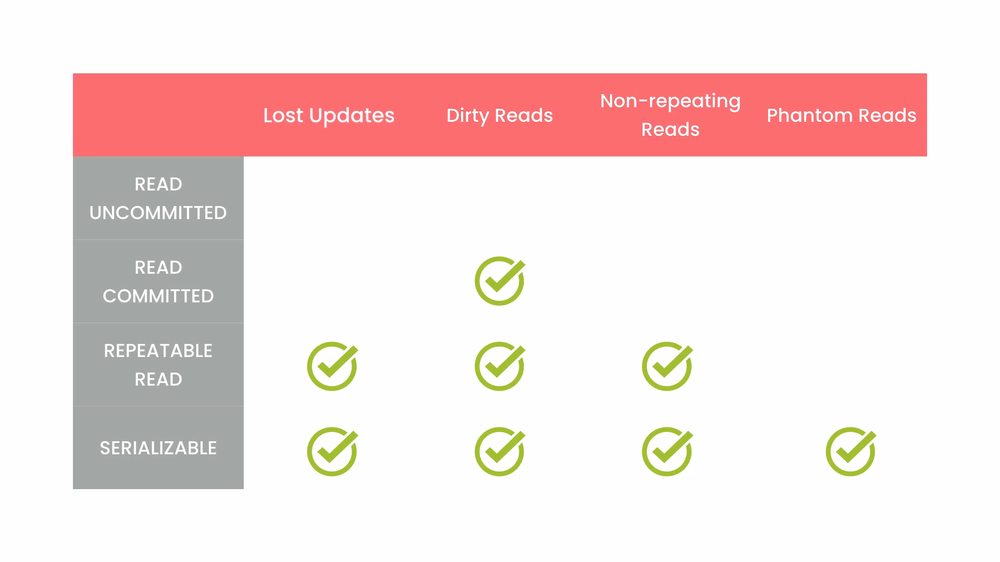

## **Data Types**

| Category               | Type                    | Description                                                                                                                           | Example / Notes                        |
| ---------------------- | ----------------------- | ------------------------------------------------------------------------------------------------------------------------------------- | -------------------------------------- |
| **Strings**            | CHAR(x)                 | Fixed-length string. Always stores exactly *x* characters, padded with spaces if necessary. Suitable for values with constant length. | `CHAR(2)` → country codes (`DZ`, `US`) |
|                        | VARCHAR(x)              | Variable-length string. Stores only the required space up to *x* characters. max : 64 KB.                                                          | —                                      |
|                        |                         | **Best practices for VARCHAR:**                                                                                                       | —                                      |
|                        |                         | • `VARCHAR(50)` → short strings (usernames, passwords)                                                                                | `username VARCHAR(50)`                 |
|                        |                         | • `VARCHAR(255)` → medium-length strings (addresses, emails)                                                                          | `address VARCHAR(255)`                 |
|                        | TEXT                    | Very long strings. Often not fully indexable. Used for large text content. max : 64 KB.                                                           | Descriptions, articles                 |
|                        | ENUM / SET              | Stores a fixed list of predefined string values.                                                                                              | `ENUM('small','medium','large')`       |
|                        |                         | **Not recommended:** modifying the list requires MySQL to rebuild the entire table, which is very expensive for tables with millions of rows. | Consider lookup tables instead         |
| **Numeric (Integers)** | TINYINT                 | Very small integer (1 byte).                                                                                                          | [-128, 127]                                    |
|                        | SMALLINT                | Small integer (2 bytes).                                                                                                              | 32000                                  |
|                        | MEDIUMINT               | Medium integer (3 bytes, MySQL-specific).                                                                                             | 8,000,000                              |
|                        | INT / INTEGER           | Standard integer (4 bytes).                                                                                                           | 123456                                 |
|                        | BIGINT                  | Large integer (8 bytes).                                                                                                              | 9223372036854775807                    |
|                        | UNSIGNED                | Integer attribute allowing only non-negative values, doubling the positive range.                                                     | `INT UNSIGNED`                         |
|                        | ZEROFILL                | Display attribute that pads numbers with leading zeros. Affects display only, not storage. Automatically implies UNSIGNED.            | `INT(5)` → `00042`            |
| **Numeric (Rational)** | DECIMAL(p, s) / NUMERIC | Fixed-precision numeric type. Used for financial and exact values.                                                                    | `DECIMAL(10,2)` → 12345.67             |
|                        | FLOAT                   | Approximate numeric type for scientific calculations. Stores very large or very small values with limited precision.                  | 123.45                                 |
|                        | DOUBLE                  | Higher precision than FLOAT. Values are approximations, not exact.                                                                    | 123.456789                             |
| **Date & Time**        | DATE                    | Stores only the date.                                                                                                                 | 2024-11-24                             |
|                        | TIME                    | Stores only the time.                                                                                                                 | 14:30:00                               |
|                        | DATETIME                | Stores date and time without timezone.                                                                                                | 2024-11-24 14:30:00                    |
|                        | TIMESTAMP               | Stores date and time. Commonly used for row creation and update tracking (`created_at`, `updated_at`).                                | Auto-managed timestamps                |
|                        | YEAR                    | Stores only the year (MySQL).                                                                                                         | 2024                                   |
| **Boolean**            | BOOLEAN / BOOL          | Logical values stored as 1 (TRUE) or 0 (FALSE).                                                                                       | TRUE, FALSE                            |
|                        |                         | **Pitfalls of BOOLEAN usage:**                                                                                                        | —                                      |
|                        |                         | • Increases database size                                                                                                             |                                        |
|                        |                         | • Slower backups                                                                                                                      |                                        |
|                        |                         | • Performance issues (file-system reads are often faster)                                                                             |                                        |
|                        |                         | • Requires extra code for reading and writing logic                                                                                   |                                        |
| **Special**            | JSON                    | Stores non-atomic, structured data. Useful for flexible schemas and complex objects.                                                  | Geographic coordinates, settings       |


**Operation on JSON data Type**
- Insertion or total-Update :


```python
UPDATE products
SET properties = '
{
    "dimensions": [1, 2, 3],
    "weight": 10,
    "manufacturer": { "name": "sony" }
}
'
WHERE product_id = 1;
```


```python
UPDATE products
SET properties = JSON_OBJECT(
    'weight', 10,
    'dimensions', JSON_ARRAY(1, 2, 3),
    'manufacturer', JSON_OBJECT('name', 'sony')
)
WHERE product_id = 1;
```

- Read :


```python

SELECT product_id, JSON_EXTRACT(properties, '$.weight') AS weight
FROM products
WHERE product_id = 1;
```


```python

SELECT product_id, properties -> '$.dimensions[0]'
FROM products
WHERE product_id = 1;
```


```python
-- double arrow operator to remove quotes from the extracted value
SELECT product_id, properties ->> '$.manufacturer.name'
FROM products
WHERE product_id = 1;
```

- Partial-Update :


```python
UPDATE products
SET properties = JSON_SET(
    properties,
    '$.weight', 20,
    '$.age', 10
)
WHERE product_id = 1;
```

- Delete some properties from the json field :


```python
UPDATE products
SET properties = JSON_REMOVE(
    properties,
    '$.age'
)
WHERE product_id = 1;
```

## **Integrity Constraints (SQL)**
Any **INSERT**, **UPDATE**, or **DELETE** operation that violates a defined constraint is **rejected by the DBMS**.

- **NOT NULL :** Prevents a column from containing `NULL` values. A value is mandatory.


```python
CREATE TABLE users (
    username VARCHAR(50) NOT NULL
);
```

- **UNIQUE :** Ensures that all values in a column are unique.


```python
CREATE TABLE users (
    email VARCHAR(255) UNIQUE
);
```

- **PRIMARY KEY :** Uniquely identifies each row in a table.


```python
CREATE TABLE users (
    id INT PRIMARY KEY
);
```

- **FOREIGN KEY :** links a column in a child table to the primary key of a parent table and prevents inserting or updating a value in the child table’s foreign key column unless that value already exists in the parent table.


```python
CREATE TABLE orders (
    user_id INT,
    FOREIGN KEY (user_id) REFERENCES users(id)
);
-- `user_id` must exist in the `users` table.
```

- **CHECK :** Restricts values to a specific **range** or **set of allowed values**.


```python
CREATE TABLE products (
    price DECIMAL(10,2),
    CHECK (price > 0)
);

CREATE TABLE employees (
    role VARCHAR(20),
    CHECK (role IN ('admin', 'manager', 'employee'))
);
```

### **Referential Integrity Actions (SQL)** 
- Defines what action the database performs on FOREIGN KEY constraints to preserve referential integrity when a parent (primay key) row is deleted or updated.

- **CASCADE :** Automatically propagates the deletion or update from the parent table to the child table.


```python
CREATE TABLE orders (
    id INT PRIMARY KEY,
    user_id INT,
    FOREIGN KEY (user_id) REFERENCES users(id)
    ON DELETE CASCADE
    ON UPDATE CASCADE
);
-- Deleting a user automatically deletes all related orders.
-- Updating a user's id updates all related orders.
```

- **SET NULL :** Sets the foreign key value to `NULL` in the child table when the referenced row is deleted or updated. 
- **Note :** The foreign key column must allow `NULL`.


```python
CREATE TABLE orders (
    id INT PRIMARY KEY,
    user_id INT NULL,
    FOREIGN KEY (user_id) REFERENCES users(id)
    ON DELETE SET NULL
);
-- Deleting a user keeps the order but sets the user_id to NULL in the reference.
```

- **RESTRICT (Default behavior) :** Prevents the deletion or update of a referenced row (primary key value) if related rows exist in the child table.


```python
CREATE TABLE orders (
    id INT PRIMARY KEY,
    user_id INT,
    FOREIGN KEY (user_id) REFERENCES users(id)
    ON DELETE RESTRICT
);
-- A user cannot be deleted if orders still reference them.
```

## **Data Definition Language (DDL)**

### **The CREATE statement**

- On Database


```python
CREATE DATABASE database_name
    [IF NOT EXISTS]
    [CHARACTER SET charset_name]
    [COLLATE collation_name];
-- CHARACTER SET specifies the default character set for :
    -- Databases.
    -- Tables.
    -- Tables' columns (after the data-type).
-- The default character-set is utf8 (inernational languages) which take 3 bytes for each character.
-- Sometimes we need to change it to reduce the database size.
-- Collations are bunch of rules of how characters are sorted (by default it case insensitive).
```

- On Table


```python
CREATE TABLE [IF NOT EXISTS] table_name (
    column_name data_type
        [NOT NULL | NULL]
        [DEFAULT default_value]
        [AUTO_INCREMENT | IDENTITY]
        [UNIQUE]
        [PRIMARY KEY]
        [CHECK (condition)]
        [REFERENCES parent_table(parent_column)],

    [CONSTRAINT constraint_name]
        PRIMARY KEY (column1, column2, ...),

    [CONSTRAINT constraint_name]
        UNIQUE (column1, column2, ...),

    [CONSTRAINT constraint_name]
        FOREIGN KEY (column1, column2, ...)
        REFERENCES parent_table (parent_column1, parent_column2, ...)
        [ON DELETE {CASCADE | SET NULL | RESTRICT | NO ACTION}]
        [ON UPDATE {CASCADE | SET NULL | RESTRICT | NO ACTION}],

    [CONSTRAINT constraint_name]
        CHECK (condition)
)
[TABLESPACE tablespace_name]
[ENGINE = engine_name]
[COMMENT = 'table comment'];

-- The storge ENGINE : specify how data are stored.
-- The storge ENGINE is defined at the table level.
-- the recent ENGINE : InnoDB = support recent features like transactions, foreign-keys...etc.
-- Database could use many storge-engine at the same time.
```

- On Index


```python
CREATE [UNIQUE] INDEX index_name
ON table_name (column1 [ASC|DESC], column2 [ASC|DESC], ...);
```

### **The ALTER statement**

- On Database


```python
RENAME DATABASE old_db_name TO new_db_name;  -- MySQL 5.1+ (rarely supported)

ALTER DATABASE database_name
    [CHARACTER SET = charset_name]       -- change default character set
    [COLLATE = collation_name]           -- change default collation
    [DEFAULT ENCRYPTION = {'Y' | 'N'}]   -- enable/disable encryption (MySQL 8.0+)
    [COMMENT = 'text'];                  -- optional comment

```

- On Table


```python
ALTER TABLE table_name
    -- Add a new column
    ADD COLUMN column_name data_type
        [NOT NULL | NULL]
        [DEFAULT default_value]
        [AUTO_INCREMENT]
        [UNIQUE | PRIMARY KEY]
        [COMMENT 'comment']
        [FIRST | AFTER existing_column],

    -- Drop a column
    DROP COLUMN column_name,

    -- Modify an existing column
    MODIFY COLUMN column_name data_type
        [NOT NULL | NULL]
        [DEFAULT default_value]
        [AUTO_INCREMENT]
        [COMMENT 'comment']
        [FIRST | AFTER existing_column],

    -- Change column name and type
    CHANGE COLUMN old_name new_name data_type
        [NOT NULL | NULL]
        [DEFAULT default_value]
        [AUTO_INCREMENT]
        [COMMENT 'comment']
        [FIRST | AFTER existing_column],

    -- Add a constraint
    ADD [CONSTRAINT constraint_name]
        {PRIMARY KEY (col1, col2, ...)
        | UNIQUE (col1, col2, ...)
        | FOREIGN KEY (col1, col2, ...) REFERENCES parent_table(parent_col1, parent_col2)
            [ON DELETE {CASCADE | SET NULL | RESTRICT | NO ACTION}]
            [ON UPDATE {CASCADE | SET NULL | RESTRICT | NO ACTION}]
        | CHECK (condition)},

    -- Drop a constraint
    DROP PRIMARY KEY,
    DROP INDEX index_name,
    DROP FOREIGN KEY fk_name,
    DROP CHECK constraint_name;

    -- Rename table
    RENAME TO new_table_name;
```

- On Index


```python
ALTER TABLE table_name RENAME INDEX old_index_name TO new_index_name;
```

### **The DROP statement**

- On Database


```python
DROP DATABASE [IF EXISTS] database_name;
```

- On Table


```python
DROP TABLE [IF EXISTS] table_name [, table_name2, ...] [CASCADE | RESTRICT];
```

- On Index


```python
DROP INDEX index_name ON table_name;
```

## **Data Manipulation Language (DML)**

### **The INSERT statement**

- Insert a single or multiple rows into a table


```python
INSERT [IGNORE] INTO table_name (column1, column2, ..., columnN)
VALUES (value1, value2, ..., valueN)
[ON DUPLICATE KEY UPDATE
column1 = value1,
column2 = value2] ;

-- Insert a single row into a table
-- IGNORE : Suppresses errors such as duplicate keys and inserts remaining rows.
-- ON DUPLICATE KEY UPDATE : If a PRIMARY KEY or UNIQUE KEY conflict occurs, the row is updated instead.


INSERT INTO table_name
VALUES (DEFAULT, value2, value3, ...);
-- Insert a single row without specifying columns (ensure all columns are provided in order)
-- Use DEFAULT for auto-increment or default-valued columns

INSERT INTO table_name (column1, column2, ..., columnN)
VALUES
(value1a, value2a, ..., valueNa),
(value1b, value2b, ..., valueNb),
(value1c, value2c, ..., valueNc);
-- Insert multiple rows in a single statement
```

- Used for copying data.


```python
INSERT INTO table_name (column1, column2, ..., columnN)
SELECT column1, column2, ..., columnN
FROM another_table
WHERE condition;
-- Insert rows from another table based on a condition

CREATE table_name AS
SELECT column1, column2, ..., columnN
FROM another_table
WHERE condition;
-- Creates a new table and copies its structure and records
-- primary key and AUTO_INCREMENT properties are not preserved
```

- Practical example : rows Hierarchical insert


```python
-- one order (parent) can have many items
INSERT INTO orders (order_id, customer_id, oreder_date, status)
VALUES (DEFAULT, 1, '01-01-2026', '1')

INSERT INTO order_items (order_id, product_id, quantity, unit_price)
VALUES (LAST_INSERT_ID(), 1, 1, 2.95),
VALUES (LAST_INSERT_ID(), 4, 2, 1.95);
```

### **The UPDATE statement**

- Update a single or multiple rows in a single table


```python
UPDATE [IGNORE] table_name
SET column1 = value1,
    column2 = value2,
    ...
[WHERE condition]
[ORDER BY column_name]
[LIMIT row_count];

-- or

UPDATE table_name
SET (column1, column2, column3) = (value1, value2, value3),
[...];

-- if the condition is omitted, all rows in the table are updated
-- IGNORE : the same as above
```

- UPDATE multiple tables


```python
UPDATE table1, table2
SET table1.column = value1,
    table2.column = value2,
[...];
```

- UPDATE with JOIN on one table based on data from another.


```python
UPDATE table1 AS t1
INNER JOIN table2 AS t2
ON t1.id = t2.id
SET t1.status = t2.status;
```

- UPDATE with subquery


```python
-- Example 01 :
UPDATE employees
SET department_name = (
    SELECT name
    FROM departments
    WHERE departments.id = employees.department_id
)
WHERE department_id IS NOT NULL;

-- The UPDATE runs row by row on employees
-- The subquery returns a single value for each row.
-- The subquery is correlated with the outer query.

-- Example 02 :
UPDATE invoices
SET
    payment_total = invoice_total * 0.5,
    payment_date = due_date
WHERE client_id IN
    (SELECT client_id
    FROM clients
    WHERE state IN ('CA', 'NY'));
```

### **The DELETE statement**

- Delete a single or multiple rows in a single table


```python
DELETE FROM table_name
[WHERE condition] -- we can use subquery in the condition the same way we have done in update
[ORDER BY column_name]
[LIMIT row_count];

-- or

TRUNCATE TABLE table_name; -- delete all records & it faster than delete
```

- DELETE with JOIN


```python
-- Example scenario : DELETE from one table
    -- orders table contains customer orders
    -- customers table contains customers
    -- We want to delete orders that belong to inactive customers
DELETE o
FROM orders AS o
JOIN customers AS c
ON o.customer_id = c.id
WHERE c.status = 'inactive';


-- Example scenario : DELETE from multiple tables
    -- orders table stores orders
    -- order_details table stores order line items
    -- We want to delete orders and their details for canceled orders
DELETE o, od
FROM orders AS o
JOIN order_details AS od
ON o.id = od.order_id
WHERE o.status = 'canceled';
```

## **Retrieving data**

### **Retrieving data from a single table**

- Complete syntax


```python
SELECT
    [ALL | DISTINCT]
    select_expr [, select_expr ...]
FROM table_references
[WHERE where_condition]
[GROUP BY {col_name | expr | position}
    [ASC | DESC], ...]
[HAVING having_condition]
[WINDOW window_name AS (window_spec)]
[ORDER BY {col_name | expr | position}
    [ASC | DESC], ...]
[LIMIT {[offset,] row_count | row_count OFFSET offset}]
[INTO OUTFILE 'file_name'
    [CHARACTER SET charset_name]
    export_options
 | INTO DUMPFILE 'file_name'
 | INTO var_name [, var_name ...]];

```

- SELECT list : 
    - Supports expressions, functions, aliases.
    - DISTINCT removes duplicate rows.


```python
SELECT [ALL | DISTINCT] column1, function_name(), expression AS alias
```

- WHERE clause (row filtering) comes with: 
    - Comparison operators : <>, !=, >, >=, <, <=
    - Logical operators : AND, OR
    - BETWEEN operator : 
    ```sql 
    WHERE column BETWEEN value1 AND value2
    ```
    - IN operator :
    ```sql 
    WHERE column IN (value1, value2, value3)
    ```
    - LIKE operator : 
        ```sql 
        WHERE column LIKE 'your_pattern'
        ```
        - "%" : for any number of characters like 'a%', '%a%', '%a'.
        - "_" : for specific number of characters like 'a______b__c'.
    - REGEXP operator :
        ```sql 
        WHERE column REGEXP 'your_pattern'
        ```
        
        - contain string : 'your_string'
        - startt with string : '^your_string'
        - end with string : 'your_string$'
        - multiple pattern : 'pattern 01 | pattern 02'
        - match any of the characters : '[abcd]'
        - match any of the characters from a range : '[a-d]'
    - The IS NULL operator :
    ```sql 
    WHERE column IS NULL
    -- or negation
    WHERE column IS NOT NULL
    ```
    - The NOT operator :
    ```sql 
    WHERE column NOT condition
    ```

- ORDER BY clause syntax :

    ```sql
    ORDER BY {col_name | expr | position}
        [ASC | DESC],
        {col_name | expr | position}
        [ASC | DESC], ...
    ```
    - single column : 
    ```sql
    ORDER BY column_name;
    ```
    - multiple columns : 
    ```sql
    ORDER BY column1 ASC, column2 DESC;
    ```
    - position : Sorts by column's position in the SELECT list
    ```sql
    SELECT column1, column2, column3
    FROM table_name
    ORDER BY 2 DESC;
    ```
    - expressions : 
    ```sql
    ORDER BY price * quantity DESC;
    ```
    - with aliases : 
    ```sql
    SELECT price * quantity AS total
    FROM orders
    ORDER BY total DESC;
    ```


- LIMIT clause syntax : 


```python
LIMIT row_count
-- or
LIMIT offset, row_count
-- or
LIMIT row_count OFFSET offset
```

- Aggregate functions


```python
-- COUNT() : Returns the number of rows.
SELECT COUNT(*) FROM employees;
SELECT COUNT(DISTINCT department_id) FROM employees;

-- SUM() : Returns the total of non-NULL values.
SELECT SUM(salary) FROM employees;

-- AVG() : Returns the average (mean) of non-NULL values.
SELECT AVG(salary) FROM employees;

-- MIN() : Returns the minimum value.
SELECT MIN(salary) FROM employees;

-- MAX() : Returns the maximum value.
SELECT MAX(salary) FROM employees;
```

- GROUP BY clause syntax :
    ```sql
    GROUP BY {col_name | expr | position}
        [ASC | DESC],
        {col_name | expr | position} ...
    ```
    - columns : 
    ```sql
    SELECT AVG(salary)
    FROM employees
    GROUP BY department_id, job_title;
    ```
    - column position : 
    ```sql
    SELECT department_id, COUNT(*)
    FROM employees
    GROUP BY 1;
    ```    
    - expressions : 
    ```sql
    SELECT YEAR(order_date) AS order_year, COUNT(*)
    FROM orders
    GROUP BY YEAR(order_date);
    ```

- HAVING clause :
    - HAVING : filters groups (dpend on SELECT list)
    - WHERE : filters rows before grouping (don't dpend on SELECT list)


```python
SELECT department_id, COUNT(*)
FROM employees
GROUP BY department_id
HAVING COUNT(*) > 5;
```

- WITH ROLLUP operator
- **Note :** when using WITH ROLLUP operator we can't use alias with group-by


```python
SELECT
    state,
    city,
    SUM(invoice_total) AS total_sales
FROM invoices i
JOIN clients c USING (client_id)
GROUP BY state, city WITH ROLLUP
```

| state | city            | total_sales |
|-------|-----------------|-------------|
| CA    | San Francisco   | 705.90      |
| CA    | NULL            | **705.90**  |
| NY    | Syracuse        | 802.89      |
| NY    | NULL            | **802.89**  |
| OR    | Portland        | 980.02      |
| OR    | NULL            | **980.02**  |
| WV    | Huntington      | 101.79      |
| WV    | NULL            | **101.79**  |
| NULL  | NULL            | **2590.60** |

### **Retrieving data from multiple tables**

- JOIN clause syntax


```python
SELECT select_list
FROM DB_name_01.table_reference
[INNER | LEFT | RIGHT | CROSS] JOIN DB_name_01.table_reference
    [ON join_condition | USING (column_list)]
```

- INNER JOIN (default JOIN) :
    - Returns only matching rows from both tables.
    - A JOIN without an ON clause produces a Cartesian product (also called a CROSS JOIN).


```python
SELECT select_list
FROM table1
INNER JOIN table2
ON table1.column = table2.column;
-- INNER keyword is optional

-- or

SELECT select_list
FROM table1, table2 [, table3 ...]
WHERE join_condition;

-- or (for multipe tables)

SELECT select_list
FROM table1
JOIN table2 ON condition1
JOIN table3 ON condition2;
```

- [OUTER] JOIN :
    - LEFT [OUTER] JOIN :
        - Returns all rows from the left table
        - Non-matching rows from the right table are filled with NULL.
    - RIGHT [OUTER] JOIN :
        - Returns all rows from the right table.
        - Non-matching rows from the left table are NULL.
    - FULL [OUTER] JOIN :
        - Returns all rows from the left & right table.
        - Non-matching rows from the right & left table are NULL.


```python
SELECT *
FROM table1
[LEFT | RIGHT | FULL] JOIN table2
ON table1.column = table2.column;
-- OUTER keyword is optional
```

- CROSS JOIN : Produces a Cartesian product.


```python
SELECT * FROM employees JOIN departments;
-- or
SELECT * FROM employees CROSS JOIN departments;
-- or
SELECT * FROM employees, departments;
```

- NATURAL JOIN : 
    - Automatically joins columns with the same name.
    - Can be risky and is rarely recommended in production.


```python
SELECT *
FROM table1
NATURAL JOIN table2;
```

- JOIN with USING :
    - Simplified form of `ON table1.column = table2.column`
    - Column appears once in the result set.


```python
SELECT *
FROM table1
JOIN table2
USING (column_name);
```

- UNION clause :
    - By default, UNION applies DISTINCT (duplicates are removed).
    - UNION ALL keeps all rows, including duplicates.
    - Column names in the result come from the first SELECT.
    - Each SELECT must return:
        - The same number of columns.
        - Compatible data types in corresponding positions.
    - ORDER BY and LIMIT apply only to the final result.


```python
SELECT select_list
FROM table_name
UNION [ALL | DISTINCT]
SELECT select_list
FROM table_name
[ORDER BY column | position]
[LIMIT row_count OFFSET offset];
```

## **Subqueries**
- Execution order:
    - Execute the subquery first.
    - Return its result.
    - Use that result in the outer query.
    
- **Notes :**
    - Parentheses are mandatory.
    - Subquery must return compatible data types.

### **Scalar Subqueries**
- Return exactly one value


```python
-- Execution logic:
    -- Calculate the average salary
    -- Compare each employee’s salary with that value
    -- Return employees earning more than average
SELECT *
FROM employees
WHERE salary > (
    SELECT AVG(salary)
    FROM employees
);
```

### **Multiple-Row Subqueries**
- Return more than one row

- **IN Operators :**


```python
-- Find products that do not appear in any order
SELECT *
FROM products
WHERE product_id NOT IN (
    SELECT DISTINCT product_id
    FROM order_items
);
-- Subquery returns all product IDs that were ordered
-- NOT IN excludes those IDs
-- Remaining products were never ordered
```

- **NULL Trap:** Values cannot be compared to NULL using standard comparison operators.
Such comparisons evaluate to UNKNOWN (neither true nor false), which results in no rows being returned.

- **ALL Keyword :**
    - Compare a value to every value returned by a subquery.
    - The condition must be true for all rows returned by the subquery.
    - If the subquery returns no rows ALL evaluates to TRUE.


```python
-- Select invoices larger than all invoices of client 3

-- Method 1 — Using an Aggregate MAX()
SELECT *
FROM invoices
WHERE invoice_total > (
    SELECT MAX(invoice_total)
    FROM invoices
    WHERE client_id = 3
);

-- Method 2 — Using ALL
SELECT *
FROM invoices
WHERE invoice_total > ALL (
    SELECT invoice_total
    FROM invoices
    WHERE client_id = 3
);

```

- **ANY/SOME Keyword :** The condition is true if it matches at least one value returned by the subquery.


```python
-- Select clients with at least two invoices
SELECT *
FROM clients
WHERE client_id IN (
    SELECT client_id
    FROM invoices
    GROUP BY client_id
    HAVING COUNT(*) >= 2
);

SELECT *
FROM clients
WHERE client_id = ANY (
    SELECT client_id
    FROM invoices
    GROUP BY client_id
    HAVING COUNT(*) >= 2
);

-- "IN" equivalent to "= ANY"
```

- **EXISTS Operator :**
    - TRUE → if the subquery returns ≥ 1 row
    - FALSE → if the subquery returns 0 rows


```python
-- Select clients that have an invoice

-- Method 1 — Using IN
SELECT *
FROM clients
WHERE client_id IN (
    SELECT DISTINCT client_id
    FROM invoices
);

-- Method 2 — Using EXISTS
SELECT *
FROM clients c
WHERE EXISTS (
    SELECT client_id
    FROM invoices
    WHERE client_id = c.client_id
);
-- SQL checks if any invoice exists
-- As soon as one row is found → TRUE
-- No need to scan the entire invoices table

-- This is called short-circuit evaluation
```

### **Correlated Subqueries**
- Correlated subqueries are subqueries that depend on the outer query.
- They are evaluated once per row, not once per query.


```python
-- Return employees whose salary is greater than the average salary of their office
SELECT *
FROM employees e
WHERE salary > (
    SELECT AVG(salary)
    FROM employees
    WHERE office_id = e.office_id
);
-- Take one employee row.
-- Find the average salary of that employee’s office.
-- Compare the employee’s salary to the result.
-- Repeat for every employee.

-- Alternative Using JOIN
SELECT e.*
FROM employees e
JOIN (
    SELECT office_id, AVG(salary) AS avg_salary
    FROM employees
    GROUP BY office_id
) o ON e.office_id = o.office_id
WHERE e.salary > o.avg_salary;
```

### **Subqueries vs Joins**
- Typically, subqueries offer better readability, whereas JOINs provide better performance.


```python
-- Clients Without Invoices

-- Method 1: Subquery
SELECT *
FROM clients
WHERE client_id NOT IN (
    SELECT DISTINCT client_id
    FROM invoices
);
-- Subquery lists all clients who have invoices
-- Outer query excludes them

-- Method 2: LEFT JOIN
SELECT *
FROM clients
LEFT JOIN invoices USING (client_id)
WHERE invoice_id IS NULL;
-- LEFT JOIN keeps all clients
-- Clients without invoices get NULL
-- Filter those rows
```

### **Where Subqueries Can Be Used?**

- **WHERE :** Filtering rows.
- **HAVING :** Filtering grouped data.


```python
-- Find products that are more expensive than Lettuce (product_id = 3)
SELECT *
FROM products
WHERE unit_price > (
    SELECT unit_price
    FROM products
    WHERE product_id = 3
);
-- Subquery finds the price of Lettuce
-- Outer query compares every product’s price to that value
-- Only more expensive products are returned
```

- **SELECT :**
    - Must return a single value (scalar subquery).
    - Is executed for each row of the outer query (unless it’s uncorrelated).
    - Acts like a calculated column.


```python
-- For each client:
    -- Total sales
    -- Overall average
    -- Difference between them

SELECT
    client_id,
    name,

    (SELECT SUM(invoice_total)
     FROM invoices
     WHERE client_id = c.client_id) AS total_sales,

    (SELECT AVG(invoice_total)
     FROM invoices) AS average,

    (SELECT total_sales) - (SELECT average) AS difference
FROM clients c;
```


```python
-- You cannot reuse a column alias in an expression.
SELECT
    invoice_total,
    (SELECT AVG(invoice_total) FROM invoices) AS invoice_average,
    invoice_total - invoice_average   -- ❌ ERROR
    invoice_total - (SELECT invoice_average)   -- ✅ CORRECTED

FROM invoices;
```

- **FROM :** 
    - Derived tables : It behaves like a temporary table that exists only for the duration of the query.
    - Must have an alias.
    - Column aliases are available outside.


```python
SELECT *
FROM (
    SELECT
        client_id,
        name,
    
        (SELECT SUM(invoice_total)
         FROM invoices
         WHERE client_id = c.client_id) AS total_sales,
    
        (SELECT AVG(invoice_total)
         FROM invoices) AS average,
    
        (SELECT total_sales) - (SELECT average) AS difference
    FROM clients c;
) AS sales_summary
WHERE total_sales IS NOT NULL;
```

## **Mysql build-in function**

### **Numeric functions**


```python
-- Rounds a number to a specified number of decimal places.
SELECT ROUND(12.567, 2);   -- 12.57
-- Truncates a number to a specified number of decimal places without rounding.
SELECT TRUNCATE(12.567, 2);   -- 12.56

-- Returns the smallest integer greater than or equal to the number.
SELECT CEILING(4.2);   -- 5
-- Returns the largest integer less than or equal to the number.
SELECT FLOOR(4.9);   -- 4

-- Returns the absolute (non-negative) value of a number.
SELECT ABS(-25);   -- 25

-- Returns a random floating-point number in the range [0, 1[.
SELECT RAND();
```

### **String Functions**


```python
-- Returns the length of a string.
SELECT LENGTH('MySQL'); -- 5

-- Converts a string to uppercase.
SELECT UPPER('mysql'); -- MYSQL

-- Converts a string to lowercase.
SELECT LOWER('MySQL'); -- mysql

-- Returns the **leftmost characters**.
SELECT LEFT('Database', 4); -- Data

-- Returns the rightmost characters.
SELECT RIGHT('Database', 4); -- base

-- Removes leading and trailing spaces (or characters).
SELECT TRIM('   MySQL   '); -- MySQL

-- Extracts a substring from a string.
SELECT SUBSTRING('Database', 1, 4); -- Data

-- Replaces all occurrences of a substring.
SELECT REPLACE('SQL Server', 'Server', 'Database'); -- SQL Database

-- Returns the position** of a substring.
SELECT LOCATE('SQL', 'MySQL Database'); -- 3

-- Concatenates multiple strings.
SELECT CONCAT('My', 'SQL'); -- MySQL
```

### **Date & Time Functions**


```python
-- Returns the current date and time.
SELECT NOW(); -- 2026-01-22 10:30:45

-- Returns the current date.
SELECT CURDATE(); -- 2026-01-22

-- Returns the current time.
SELECT CURTIME(); -- 10:30:45

-- Extracts the year from a date.
SELECT YEAR('2024-08-15'); -- 2024

-- Extracts the month number from a date.
SELECT MONTH('2024-08-15'); -- 8

-- Extracts the day of the month.
SELECT DAY('2024-08-15'); -- 15

-- Extracts the hour from a datetime.
SELECT HOUR('2026-01-22 10:30:45'); -- 10

-- Extracts the minute from a datetime.
SELECT MINUTE('2026-01-22 10:30:45'); -- 30

-- Extracts the second from a datetime.
SELECT SECOND('2026-01-22 10:30:45'); -- 45

-- Returns the name of the day.
SELECT DAYNAME('2026-01-22'); -- Thursday

-- Returns the name of the month.
SELECT MONTHNAME('2026-01-22'); -- January

-- Extracts a specific part of a date or time.
SELECT EXTRACT(YEAR FROM '2026-01-22 10:30:45'); -- 2026

-- Formats a date according to a specified format.
SELECT DATE_FORMAT('2026-01-22', '%d/%m/%Y'); -- 22/01/2026

-- Formats a time according to a specified format.
SELECT TIME_FORMAT('10:30:45', '%H:%i'); -- 10:30

-- Adds a time interval to a date.
SELECT DATE_ADD('2026-01-22', INTERVAL 5 DAY); -- 2026-01-27

-- Subtracts a time interval from a date.
SELECT DATE_SUB('2026-01-22', INTERVAL 2 MONTH); -- 2025-11-22

-- Returns the difference in days between two dates.
SELECT DATEDIFF('2026-01-22', '2026-01-10'); -- 12

-- Converts a time value to seconds.
SELECT TIME_TO_SEC('01:02:03'); -- 3723
```

### **Nullish functions**


```python
-- Returns the second value if the first one is NULL.
SELECT IFNULL(NULL, 'Default value'); -- Default value

-- Returns the first non-NULL value in the list.
SELECT COALESCE(NULL, NULL, 'First not null', 'Other'); -- First not null
```

### **Conditional expression**


```python
-- IF condition is true, return value1, else value2.
SELECT IF(10 > 5, 'Yes', 'No'); -- Yes

-- Conditional expression using CASE .
SELECT
  CASE 2
    WHEN 1 THEN 'One'
    WHEN 2 THEN 'Two'
    WHEN 3 THEN 'Three'
    ELSE 'Unknown'
  END AS alias; -- Two
```

## **Views**
- A VIEW is a virtual table based on the result of a SELECT query.
- It does not store data, only the query definition.

### **Create, Update and Delete a View**


```python
-- CREATE if not exist or UPDATE the view by the "OR REPLACE" keyword
CREATE [OR REPLACE] [TEMPORARY] VIEW view_name AS
SELECT column1, column2, ...
FROM table_name
[WHERE condition]
[GROUP BY ...]
[HAVING ...]
[ORDER BY ...]
[WITH CHECK OPTION];

-- To delete a views
DROP VIEW [IF EXISTS] view_name [, view_name2, ...];
```

- Pracitcal example :


```python
CREATE VIEW sales_by_client AS
SELECT
    c.client_id,
    c.name,
    SUM(invoice_total) AS total_sales
FROM clients c
JOIN invoices i USING (client_id)
GROUP BY client_id, name;

SELECT *
FROM sales_by_client
WHERE total_sales > 500;

DROP VIEW IF EXISTS sales_by_client;
```

### **Insert, Update & Delete data througt views**
- A view can only be modified if:  

- It references only one table. 


```python
-- This view can be updated because it references only one table (`employees`).
CREATE VIEW EmployeeView AS
SELECT id, name, department_id FROM employees;

-- This view cannot be updated because it references two tables.
CREATE VIEW EmployeeDepartmentView AS
SELECT e.name, d.department_name 
FROM employees e JOIN departments d ON e.department_id = d.id;
```

- The SELECT statement of the view does not contain GROUP BY, ORDER BY, DISTINCT, subqueries, etc.


```python
-- This view can be updated.
CREATE VIEW ActiveEmployees AS
SELECT id, name FROM employees WHERE active = 1;

-- This view cannot be updated because it uses DISTINCT.
CREATE VIEW DistinctDepartments AS
SELECT DISTINCT department_id FROM employees;
```

- All required fields in the source table are included in the view's SELECT statement.


```python
-- If the underlying table `employees` has columns: `id, name, department_id, salary, hire_date`.
CREATE VIEW SimpleEmployee AS
SELECT id, name FROM employees; -- missing department_id which is NOT NULL & without defaults value
-- This view cannot be updated via INSERT because `department_id` is required but not in the view.
```

- The inserted or updated values respect the conditions of the view's WHERE clause when using the **WITH CHECK OPTION**.


```python
-- View with WHERE and WITH CHECK OPTION:
CREATE VIEW HighSalaryEmployees AS
SELECT id, name, salary FROM employees WHERE salary > 50000
WITH CHECK OPTION;

-- If you try to update or insert a row with `salary <= 50000` 
-- through this view, it will be rejected because it violates the WHERE condition.
UPDATE HighSalaryEmployees SET salary = 40000 WHERE id = 101; -- Fails
INSERT INTO HighSalaryEmployees (id, name, salary) VALUES (202, 'Jane', 30000); -- Fails
```

## **Control Flow & Variables**

### **Variables in MySQL**
- MySQL has three main types of variables:


```python
-- User (Session) Variables
SET @counter = 10;

-- Local Variables (Stored Programs)
    -- Must be declared at the beginning of a block.
    -- Scope is limited to the block.
DECLARE total DECIMAL(9,2) [DEFAULT value];
-- Local variables must follow this exact order inside a block:
    -- DECLARE variables
    -- DECLARE cursors
    -- DECLARE handlers

-- System Variables
    -- Control server behavior (Read-only or configurable).
SELECT @@autocommit;
```

- Assigning Values to Variables


```python
SET total = 500;

-- or 

SELECT COUNT(*), COALESCE(SUM(invoice_total), 0)
INTO invoice_count, total_sales
FROM invoices;
```

### **Control Flow**
- You can use control flow in:
    - Stored procedures.
    - Functions.
    - Triggers.
    - Events.

- **The BEGIN ... END Block**


```python
BEGIN
    -- declarations
    -- statements
END

-- Nested Blocks
BEGIN
    DECLARE x INT DEFAULT 10;

    BEGIN
        DECLARE y INT DEFAULT 20;
        SET x = x + y;
    END;

END;
-- Inner variables cannot be seen outside
-- Outer variables are visible inside
```

- **IF … ELSEIF … ELSE**


```python
IF condition1 THEN
    statements;
ELSEIF condition2 THEN
    statements;
ELSE
    statements;
END IF;

-- NULL Conditions
IF total = NULL THEN -- ❌ Wrong
IF total IS NULL THEN --✅ Correct
```

- **CASE Statement**
    - You can use CASE & IF statements directly in a SELECT statement, not only in stored programs.


```python
CASE expression
    WHEN value1 THEN result1
    WHEN value2 THEN result2
    ELSE result_default
END

-- example:
DECLARE score INT DEFAULT 85;
DECLARE grade CHAR(1);

SET grade = CASE score
    WHEN 100 THEN 'A+'
    WHEN 90 THEN 'A'
    WHEN 80 THEN 'B'
    ELSE 'C'
END;
```

- **LOOP Statement**


```python
[loop_label:] LOOP
    statements;
END LOOP [loop_label];

-- example : 
DELIMITER $$

CREATE PROCEDURE loop_demo()
BEGIN
    DECLARE counter INT DEFAULT 1;

    my_loop: LOOP
        IF counter > 5 THEN
            LEAVE my_loop;  -- exit loop
        END IF;

        SELECT counter;  -- do something
        SET counter = counter + 1;
    END LOOP my_loop;
END$$

DELIMITER ;
```

- **WHILE Loop**


```python
[loop_label:] WHILE condition DO
    statements;
END WHILE [loop_label];

-- example : 
DELIMITER $$

CREATE PROCEDURE while_demo()
BEGIN
    DECLARE counter INT DEFAULT 1;

    WHILE counter <= 5 DO
        SELECT counter;
        SET counter = counter + 1;
    END WHILE;
END$$

DELIMITER ;
```

- **REPEAT Loop**


```python
[loop_label:] REPEAT
    statements;
UNTIL condition
END REPEAT [loop_label];

-- example : 
DELIMITER $$

CREATE PROCEDURE repeat_demo()
BEGIN
    DECLARE counter INT DEFAULT 1;

    REPEAT
        SELECT counter;
        SET counter = counter + 1;
    UNTIL counter > 5
    END REPEAT;
END$$

DELIMITER ;
```

- **ITERATE and LEAVE**


```python
-- WHILE With LEAVE and ITERATE
WHILE i <= 10 DO
    IF i = 5 THEN
        SET i = i + 1;
        ITERATE;  -- skip this iteration
    END IF;

    IF i = 8 THEN
        LEAVE;    -- exit loop
    END IF;

    SELECT i;
    SET i = i + 1;
END WHILE;


-- REPEAT With LEAVE and ITERATE
DECLARE i INT DEFAULT 1;

my_loop: REPEAT
    IF i = 3 THEN
        SET i = i + 1;
        ITERATE my_loop;  -- skip current iteration
    END IF;

    IF i = 6 THEN
        LEAVE my_loop;     -- exit loop
    END IF;

    SELECT i;
    SET i = i + 1;
UNTIL i > 10
END REPEAT my_loop;
```

## **Stored Procedures**
- A stored procedure is a named set of SQL statements that is:
    - Stored inside the MySQL server.
    - Compiled once.
    - Executed on demand using CALL.

### **Opertions on Stored Procedures**


```python
-- Create Stored Procedure
DELIMITER //

CREATE PROCEDURE procedure_name ([ {IN | OUT | INOUT} parameter_name datatype])
[characteristics]
BEGIN
    -- SQL statements
END //

DELIMITER ;

-- Viewing Stored Procedures
SHOW PROCEDURE STATUS
WHERE Db = 'db_name';
-- or
SHOW CREATE PROCEDURE procedure_name;


-- CALL Stored Procedure
CALL procedure_name([Arguments]);

-- Drop Stored Procedure
DROP PROCEDURE IF EXISTS procedure_name;
-- Procedures cannot be edited .Therefore, To change logic:
    -- Drop the procedure.
    -- Recreate it.

```

- Characteristics (Optional) :
    - `DETERMINISTIC` → Procedure always returns the same result for same input.
    - `NOT DETERMINISTIC` → Result may vary.
    - `CONTAINS SQL` → Procedure contains SQL statements but does not read or modify data.
    - `READS SQL DATA` → Reads data but does not modify.
    - `MODIFIES SQL DATA` → Can modify data.
    - `SQL SECURITY DEFINER` → Executes with privileges of the creator.
    - `SQL SECURITY INVOKER` → Executes with privileges of the caller.

- practical examples


```python
--------------without parameters-----------------
DELIMITER $$

CREATE PROCEDURE get_clients()
BEGIN
    SELECT * FROM clients;
END$$

DELIMITER ;

CALL get_clients();
```


```python
--------------with parameters-----------------
-- example 01 : input parameters

DELIMITER $$

CREATE PROCEDURE get_clients_by_state(
    state CHAR(2)
)
BEGIN
    SELECT * 
    FROM clients c
    WHERE c.state = state;
END$$

DELIMITER ;

CALL get_clients_by_state('CA');

-- example 02 : input and output parameters

DELIMITER $$

CREATE PROCEDURE get_unpaid_invoices_for_client(
    IN client_id INT,
    OUT invoices_count INT,
    OUT invoices_total DECIMAL(9, 2)
)
BEGIN
    SELECT COUNT(*), SUM(invoice_total)
    INTO invoices_count, invoices_total
    FROM invoices i
    WHERE i.client_id = client_id
    AND payment_total = 0;
END$$

DELIMITER ;

-- Set variables to store output parameters
SET @invoices_count = 0;
SET @invoices_total = 0;
-- SET keyword : is used to assign values

-- Call the stored procedure
CALL sql_invoicing.get_unpaid_invoices_for_client(3, @invoices_count, @invoices_total);

-- Display the results
SELECT @invoices_count AS unpaid_invoice_count, @invoices_total AS total_unpaid_amount;
```


```python
--------------with parameters & default value simulation-----------------
CREATE PROCEDURE get_clients_by_state(
    state CHAR(2)
)
BEGIN
    IF state IS NULL THEN
        SELECT * 
        FROM clients;
    ELSE
        SELECT * 
        FROM clients c
        WHERE c.state = state;
    END IF;    
END$$

-- or (Shorter Code)

CREATE PROCEDURE get_clients_by_state(
    state CHAR(2)
)
BEGIN
    SELECT * 
    FROM clients c
    WHERE c.state = IFNULL(state, c.state);   
END$$

CALL get_clients_by_state('CA');   -- Filtered
CALL get_clients_by_state(NULL);   -- All clients
```

### **Local & Session Variables**

- Session/User Variables : 
    - Start with @.
    - Exist outside procedures, across the session.
    - Can be used to store outputs from procedures.


```python
SET @total_invoices = 0;
CALL get_unpaid_invoices_for_client(3, @count, @total_invoices);
SELECT @total_invoices;

```

- Local Variables :
    - Declared inside the procedure.
    - Only accessible within that procedure.
    - Must be declared at the top of the BEGIN block.


```python
CREATE PROCEDURE get_risk_factor()
BEGIN
    DECLARE risk_factor DECIMAL(9, 2) DEFAULT 0;
    DECLARE invoices_total DECIMAL(9, 2);
    DECLARE invoices_count INT;
    
    SELECT COUNT(*), SUM(invoice_total)
    INTO invoices_count, invoices_total
    FROM invoices;

    SET risk_factor = invoices_total / invoices_count * 5;

    SELECT risk_factor;
END$$

DELIMITER ;
```

### **Error Handling in a Procedure**
- Procedure execution stops immediately
- The error is returned to the caller


```python
DELIMITER $$

CREATE PROCEDURE make_payment(
    p_invoice_id INT,
    p_payment_amount DECIMAL(9, 2),
    p_payment_date DATE
)
BEGIN
    -- Validate payment amount
    IF p_payment_amount <= 0 THEN
        SIGNAL SQLSTATE '45000'
        SET MESSAGE_TEXT = 'Invalid payment amount. Payment must be greater than 0.';
    END IF;
    
    -- Update the invoice
    UPDATE invoices i
    SET 
        i.payment_total = p_payment_amount,
        i.payment_date = p_payment_date
    WHERE i.invoice_id = p_invoice_id;
END$$

DELIMITER ;

CALL make_payment(1, -50, '2024-01-01');
-- ERROR 1644 (45000): Invalid payment amount. Payment must be greater than 0.

```

## **Functions**
- A function is a stored program that must returns a single value.
- Unlike procedures, functions can be used directly in SQL queries.
- Functions cannot modify data (INSERT, UPDATE, DELETE)


```python
DELIMITER //

CREATE FUNCTION function_name ([parameters])
RETURNS data_type
[characteristics]
BEGIN
    -- SQL statements
    RETURN value;
END //

DELIMITER ;
```

- practical example :


```python
DELIMITER $$

CREATE FUNCTION get_risk_factor_for_client (
    client_id INT
) RETURNS DECIMAL(9, 2)
READS SQL DATA
BEGIN
    DECLARE risk_factor DECIMAL(9, 2) DEFAULT 0;
    DECLARE invoices_total DECIMAL(9, 2);
    DECLARE invoices_count INT;
    
    SELECT COUNT(*), COALESCE(SUM(invoice_total), 0)
    INTO invoices_count, invoices_total
    FROM invoices i
    WHERE i.client_id = client_id;
    
    SET risk_factor = invoices_total / invoices_count;

    RETURN IFNULL(risk_factor, 0);
END$$

DELIMITER ;

-- calling the created function
SELECT
    client_id,
    name,
    get_risk_factor_for_client(client_id) AS risk_factor
FROM clients;

DROP FUNCTION IF EXISTS get_risk_factor_for_client;
-- Functions cannot be edited directly.
-- Therfore, you must drop it and recreate it.
```

## **Cursors**
- A cursor is a database object that allows row-by-row processing of query results.
- Are ONLY allowed inside stored procedures

### **Cursor Lifecycle**
- DECLARE the cursor.
- OPEN the cursor.
- FETCH rows one by one.
- CLOSE the cursor.


```python
DELIMITER $$

CREATE PROCEDURE cursor_example()
BEGIN
    DECLARE v_id INT;
    DECLARE v_name VARCHAR(100);
    DECLARE v_price DECIMAL(10,2);
    DECLARE done INT DEFAULT 0;

    DECLARE cur_products CURSOR FOR
        SELECT id, name, price FROM products;

    DECLARE CONTINUE HANDLER FOR NOT FOUND SET done = 1;

    OPEN cur_products;

    read_loop: LOOP
        FETCH cur_products INTO v_id, v_name, v_price;

        IF done = 1 THEN
            LEAVE read_loop;
        END IF;

        -- Example processing
        INSERT INTO product_log(product_id, price)
        VALUES (v_id, v_price);
    END LOOP;

    -- or (Alternative Loop: WHILE)------------
    WHILE done = 0 DO
        FETCH cur_products INTO v_id, v_price;
        
        -- Example processing
        INSERT INTO product_log(product_id, price)
        VALUES (v_id, v_price);
    END WHILE;
    ----------------------------------------

    CLOSE cur_products;
END$$

DELIMITER ;

```

## **Triggers**

- Trigger is a block of code that got executed before or after update insert or delete statement.
- Tied to a specific table
- Use Cases :
    - Validate or correct data (Example: prevent negative payments).
    - Log inserted, updated & deleted rows in an audit table.
    - Enforce constraints that cannot be done with foreign keys alone.

### **Opertions on Triggers**


```python
-- Create a trigger

DELIMITER $$

CREATE TRIGGER trigger_name
{BEFORE | AFTER} {INSERT | UPDATE | DELETE}
ON table_name
FOR EACH ROW 
-- It fires once per affected (inserted, updated or deleted) row (FOR EACH ROW).
BEGIN
    -- trigger logic
END$$

DELIMITER ;
```


```python
-- Viewing Existing Triggers

-- List all triggers
SHOW TRIGGERS;

-- Triggers for a specific table
SHOW TRIGGERS LIKE 'clients';

-- View trigger definition
SHOW CREATE TRIGGER trigger_name;
```


```python
-- Dropping a Trigger
DROP TRIGGER IF EXISTS trigger_name;
-- Triggers cannot be edited directly.
-- Therfore, you must drop it and recreate it.
```

### **Timing & Events**
- For Timing :
    - **BEFORE :** Runs before the event, can modify the ``new`` data (new rows values).
    - **AFTER :** Runs after the event, cannot change the data that triggered it (Read-only new rows).
    - You cannot modify OLD rows values
- For Events :

| Trigger Event | `NEW` | `OLD` |
|---------------|-------|-------|
| INSERT        | ✅    | ❌    |
| UPDATE        | ✅    | ✅    |
| DELETE        | ❌    | ✅    |


- **Use cases examples**


```python
-- Tables (payments & invoices) consistency

DELIMITER $$

CREATE TRIGGER payments_after_insert
    AFTER INSERT ON payments
    FOR EACH ROW
BEGIN
    UPDATE invoices
    SET payment_total = payment_total + NEW.amount
    WHERE invoice_id = NEW.invoice_id;
END $$

DELIMITER ;

INSERT INTO payments
VALUES (DEFAULT, 5, 3, '2019-01-01', 10, 1);

-----------------------------------------------------

DELIMITER $$

CREATE TRIGGER payments_after_delete
    AFTER DELETE ON payments
    FOR EACH ROW
BEGIN
    UPDATE invoices
    SET payment_total = payment_total - OLD.amount
    WHERE invoice_id = OLD.invoice_id;
END $$

DELIMITER ;

DELETE FROM payments
WHERE payment_id = 10;
```


```python
-- Auditing table (clients_audit)
CREATE PROCEDURE log_clients(p_table VARCHAR(64), p_id INT)
BEGIN
    INSERT INTO clients_audit (table_name, row_id, change_time)
    VALUES (p_table, p_id, NOW());
END;

DELIMITER $$

CREATE TRIGGER clients_after_update
AFTER UPDATE ON clients
FOR EACH ROW
BEGIN
    CALL log_clients('clients', NEW.client_id);
END$$

DELIMITER ;
```


```python
-- Validate and correct data
DELIMITER $$

CREATE TRIGGER clients_before_insert
BEFORE INSERT ON clients
FOR EACH ROW
BEGIN
    IF NEW.state IS NULL THEN
        SET NEW.state = 'CA';
    END IF;
END$$

DELIMITER ;
```

### **Execution Order**
- when multiple triggers on the same table have the same events & timing.
- **Notes :**
    - All BEFORE triggers execute first.
    - All AFTER triggers execute last.


```python
-- First trigger — validation
CREATE TRIGGER products_validate_price
BEFORE INSERT ON products
FOR EACH ROW
BEGIN
    IF NEW.price < 0 THEN
        SIGNAL SQLSTATE '45000'
        SET MESSAGE_TEXT = 'Price cannot be negative';
    END IF;
END;

-- Second trigger — default value runs after validation:

CREATE TRIGGER products_set_default_stock
BEFORE INSERT ON products
FOR EACH ROW
FOLLOWS products_validate_price 
-- FOLLOWS keyword for ordering
BEGIN
    IF NEW.stock IS NULL THEN
        SET NEW.stock = 0;
    END IF;
END;
```

### **Infinite recursion problem**
- A trigger cannot modify the table that activated it


```python
-- Problem :
CREATE TRIGGER orders_after_insert
AFTER INSERT ON orders
FOR EACH ROW
BEGIN
    UPDATE orders
    SET status = 'NEW'
    WHERE order_id = NEW.order_id;
END;

-- Solution: 
CREATE TRIGGER orders_before_insert
BEFORE INSERT ON orders
FOR EACH ROW
BEGIN
    SET NEW.status = 'NEW';
END;
```

## **Events**

- An event is a task that gets executed according to a schedule.
- **Event Scheduler :** 
    - It is background thread responsible for executing events when their scheduled time arrives.
    - If the scheduler is OFF → events do nothing.


```python
-- To see whether the scheduler is enabled
SHOW VARIABLES LIKE 'event_scheduler';

-- Enable it for the current MySQL session
SET GLOBAL event_scheduler = ON;

-- To enable it Permanently, edit the MySQL configuration file (my.cnf or my.ini).
event_scheduler=ON

-- Verifying That Events Are Running
SHOW PROCESSLIST;
-- result : event_scheduler | Waiting on empty queue
```

- If an event fails:
    - MySQL logs the error.
    - The event continues to exist.
    - Next execution still occurs.

### **Opertions on Events**


```python
------------------ CREATE EVENT--------------------------
[DELIMITER $$] -- (begin ... end) block used for multiple statments

CREATE EVENT event_name
ON SCHEDULE {AT specific_time | EVERY time_interval}
[STARTS specific_time]
[END specific_time]
DO [BEGIN]
    -- event_body;
[END$$]

[DELIMITER ;]

-- examples :
-- time_interval : 1 {SECOND | MINUTE | HOUR | DAY | WEEK | MONTH | YEAR}.
-- specific_time : '2026-02-01 00:00:00', NOW() + INTERVAL 7 DAY.

DELIMITER $$

CREATE EVENT conditional_cleanup
ON SCHEDULE EVERY 1 DAY
DO
BEGIN
    IF DAYOFWEEK(CURDATE()) = 1 THEN
        DELETE FROM logs
        WHERE created_at < NOW() - INTERVAL 30 DAY;
    END IF;
END$$

DELIMITER ;

-- or (cleaner code and faster)

CREATE EVENT conditional_cleanup
ON SCHEDULE EVERY 1 DAY
DO
    CALL sundays_log_cleanup();


-- Runs cleanup only on Sundays
-- deleting logs older than 30 days from now (Sunday).
```


```python
------------------Viewing created events--------------------------
-- Checking Created Events
SHOW EVENTS;

-- Show events that match the pattern.
SHOW EVENTS LIKE '%pattern%';
```


```python
------------------ DROP EVENT--------------------------
DROP EVENT IF EXISTS event_name;
```


```python
------------------ Modifying EVENT--------------------------
-- on time :
ALTER EVENT daily_cleanup
ON SCHEDULE EVERY 12 HOUR;

-- on body :
DELIMITER $$

ALTER EVENT daily_cleanup
DO
BEGIN
    DELETE FROM logs
    WHERE created_at < NOW() - INTERVAL 14 DAY;
END$$

DELIMITER ;

-- on both :
DELIMITER $$

ALTER EVENT yearly_delete_stale_audit_rows
ON SCHEDULE
    EVERY 1 YEAR STARTS '2019-01-01' ENDS '2029-01-01'
DO BEGIN
    DELETE FROM payments_audit
    WHERE action_date < NOW() - INTERVAL 1 YEAR;
END $$

DELIMITER ;

-- clearing 1 year old action_date from "payments_audit" table.
-- every one year.

-- Enable or Disable the event
ALTER EVENT yearly_delete_stale_audit_rows ENABLE;
ALTER EVENT yearly_delete_stale_audit_rows DISABLE;
```

## **Transactions and Concurrency**

### **Transactions**
- A transaction is a group of SQL statements that must be executed as a single unit (all succeed or all fail).
    - COMMIT → make changes permanent.
    - ROLLBACK → undo all changes.
- Transaction are ACID (Atomic, Consistent, Isolated, Durable).


```python
-- This is the standard production pattern.
START TRANSACTION;

-- operations

IF problem THEN
    ROLLBACK;
ELSE
    COMMIT;
END IF;

-- example (simple):
START TRANSACTION;

INSERT INTO orders (customer_id, order_date, status)
VALUES (1, '2019-01-01', 1);

INSERT INTO order_items
VALUES (LAST_INSERT_ID(), 1, 1, 1);

COMMIT;
```

- **SAVEPOINT :** partial rollback


```python
START TRANSACTION;
INSERT INTO clients VALUES (1, 'A');
SAVEPOINT step1;
INSERT INTO clients VALUES (2, 'B');
ROLLBACK TO step1;
COMMIT;

-- insert A .
-- savepoint created.
-- insert B.
-- rollback to step1 → removes B only.
-- commit → A saved.
```

- When the system variable `autocommit` is enabled (default value = ON), MySQL treats each SQL statement as a separate transaction and automatically commits it if no error occurs.


```python
SHOW VARIABLE LIKE 'autocommit%';

-- Turning autocommit ON
SET autocommit = 1;

-- Turning autocommit OFF
SET autocommit = 0;
-- Now: Changes are not permanent, Until you call COMMIT
-- example :
UPDATE accounts SET balance = 500 WHERE id = 1;
commit; -- Now Changes are permanent
```

### **Concurrency problems**

- **Lost Update :** One update overwrites another.


```python
-- Session A
START TRANSACTION;
UPDATE customers SET state = 'VA' WHERE id = 1; 
COMMIT; 

-- Session B
START TRANSACTION;
UPDATE customers SET points = 20 WHERE id = 1;
COMMIT;

-- 'A' start before 'B' then waiting for 'B' to commit.
```

<center>

</center>

- **Dirty Read :** Reading uncommitted data.


```python
-- Session A
START TRANSACTION;
UPDATE customers SET points = 20 WHERE id = 1;
ROLLBACK; 

-- Session B
SELECT points FROM customers WHERE id = 1; -- points = 20

-- 'A' update points without commiting or rolling-back
-- then 'B' read updated value (points = 20)
-- finally 'A' rollback the update.
```

<center>

</center>

- **Non-Repeatable Read :** Same row gives different values inside same transaction.


```python
-- Session A
START TRANSACTION;
UPDATE customers SET points = 0 WHERE id = 1;
ROLLBACK; 

-- Session B
SELECT points -- points = 10
FROM customers 
WHERE points = 
        (SELECT points 
         FROM customers 
         WHERE id = 1); -- points = 0

-- The first select of 'B' read the unupdated value (points = 10)
-- while the subquery read the updated one (points = 0)
-- which are not the same.
```

<center>

</center>

- **Phantom Read :** Rows appear/disappear between queries


```python
-- Session A
START TRANSACTION;
SELECT COUNT(*) FROM orders WHERE amount > 100; -- 5 : Before 'B' commiting.
SELECT COUNT(*) FROM orders WHERE amount > 100; -- 6 : After 'B' commiting.
COMMIT;

-- Session B
START TRANSACTION;
INSERT INTO orders VALUES (... 200 ...);
COMMIT;
```

### **Isolation Levels**

- **READ UNCOMMITTED** 
- **READ COMMITTED**
- **REPEATABLE READ (default):** read data depend on a snapshot.
- **SERIALIZABLE :** treat one transaction at a time. 

<center>

</center>


```python
-- For session
SET SESSION TRANSACTION ISOLATION LEVEL REPEATABLE READ;

-- For next transaction only
SET TRANSACTION ISOLATION LEVEL SERIALIZABLE;
START TRANSACTION;
    -- sql statments
COMMIT;

-- Check current level
SELECT @@transaction_isolation;
```

### **Locks mechanism**

- **Row-level lock:** When concurrent transactions attempt to modify the same row, MySQL locks that row so other transactions are blocked until the current transaction finishes with a COMMIT or ROLLBACK.


```python
-- Session A
START TRANSACTION;
UPDATE accounts SET balance = balance - 100 WHERE id = 1; -- stop here without commiting
COMMIT; 

-- Session B
UPDATE accounts SET balance = 50 WHERE id = 1;
-- waits ⏳ (blocked)
-- Until: A commits or rollbacks.
```

- **SELECT :** statements do not place locks (default). Instead, MySQL reads from a consistent snapshot of the data, allowing other transactions to continue modifying rows without being blocked.
- **SELECT … FOR UPDATE :** locks rows as if you updated them.
- **SELECT … LOCK IN SHARE MODE :** Allows other readers but not to writers.

- **Deadlocks problem:** Two transactions waiting for each other forever.


```python
-- Session A
UPDATE accounts SET balance = 0 WHERE id = 1;

-- Session B
UPDATE accounts SET balance = 0 WHERE id = 2;


-- Now:

-- Session A
UPDATE accounts SET balance = 0 WHERE id = 2; -- waits for Session B

-- Session B
UPDATE accounts SET balance = 0 WHERE id = 1; -- waits for Session A

-- both stuck forever :
-- MySQL automatically 
    -- detects deadlock 
    -- kills one transaction
    -- returns error: ERROR 1213 (40001): Deadlock found
```

## **Error Handling**

### **Errors**
- Every MySQL error contains three elements: `ERROR <error_number> (<SQLSTATE>): <message>`
    - Error Number → MySQL-specific code (onely for one error).
    - SQLSTATE → ANSI/ISO standard error class (for multiple errors) & it format :
        - CCSSS (5 digits): 
            - CC : Class (general category).
            - SSS : Subclass (specific condition).
    - Message Text → Human-readable explanation.


```python
-- Viewing Error Information
SHOW ERRORS;
```

### **Errors' scope**


```python
DELIMITER $$

CREATE PROCEDURE demo_signal()
BEGIN
    BEGIN
        SELECT 'Before error';
        SIGNAL SQLSTATE '45000'
        SET MESSAGE_TEXT = 'Boom!';
    END;
    SELECT 'After error'; -- ❌ never executed (The error propagates upward)
END$$

DELIMITER ;

CALL demo_signal();
SELECT 'Still running';

-- Before error
-- ERROR 1644 (45000): Boom!
-- Still running
```

### **Catching errors**
- Outside stored programs' errors cannot be handeled.


```python
-- Declaring a Named Condition :
    -- give a meaningful name to an error condition.
DECLARE condition_name CONDITION FOR condition_value;

-- Declaring a HANDLER :
    -- Handlers define what to do when a condition occurs.
DECLARE handler_type HANDLER FOR condition
handler_statement;

-- handler_type :
    -- CONTINUE : Continue execution
    -- EXIT : Exit the current block

-- condition :
    -- Error number.
    -- SQLSTATE value.
    -- A named condition.
    -- Generic categories (SQLEXCEPTION, SQLWARNING, NOT FOUND).

-- handler_statement : can be a single or multiple (BEGIN...END) statements.

-- Example :

DELIMITER $$

CREATE PROCEDURE demo_handlers(
    IN p_id INT,
    IN p_name VARCHAR(100)
)
BEGIN
    -------------------------------------------------
    -- Variables
    -------------------------------------------------
    DECLARE v_count INT DEFAULT 0;

    -------------------------------------------------
    -- Named condition (duplicate key error)
    -- MySQL error 1062 = duplicate entry
    -------------------------------------------------
    DECLARE duplicate_key CONDITION FOR 1062;

    -------------------------------------------------
    -- Handlers
    -------------------------------------------------

    -- 1) CONTINUE handler using named condition
    DECLARE CONTINUE HANDLER FOR duplicate_key
    BEGIN
        SELECT 'Duplicate ID detected (named condition handler)' AS msg;
    END;

    -- 2) CONTINUE handler using SQLSTATE
    -- 02000 = NOT FOUND
    DECLARE CONTINUE HANDLER FOR SQLSTATE '02000'
    BEGIN
        SELECT 'No row found (SQLSTATE handler)' AS msg;
    END;

    -- 3) CONTINUE handler using generic SQLWARNING
    DECLARE CONTINUE HANDLER FOR SQLWARNING
    BEGIN
        SELECT 'Warning occurred' AS msg;
    END;

    -- 4) EXIT handler using generic SQLEXCEPTION
    DECLARE EXIT HANDLER FOR SQLEXCEPTION
    BEGIN
        SELECT 'Unexpected error, exiting procedure' AS msg;
    END;

    -------------------------------------------------
    -- Procedure logic
    -------------------------------------------------

    -- Try inserting (may trigger duplicate key)
    INSERT INTO users(id, name)
    VALUES(p_id, p_name);

    -- Try selecting a row that may not exist (triggers NOT FOUND)
    SELECT id INTO v_count
    FROM users
    WHERE id = -1;

    SELECT 'Procedure completed normally' AS msg;

END$$

DELIMITER ;
```

### **Custom Errors**

- **SIGNAL :** allows you to explicitly raise an error or warning.


```python
DELIMITER $$

CREATE PROCEDURE handler_demo(IN pos_number INT)
BEGIN
    -- continue handler (does NOT stop execution)
    DECLARE CONTINUE HANDLER FOR SQLEXCEPTION
        SELECT 'An error occurred' AS msg;

    IF pos_number < 0 THEN
        SIGNAL SQLSTATE '45000'
        SET MESSAGE_TEXT = 'Custom error message',
            MYSQL_ERRNO = 10001;
    END IF;

    SELECT 'After error' AS msg;
END$$

DELIMITER ;

CALL handler_demo(-1);
-- An error occurred
-- After error

-- '45000' = user-defined exception
-- MYSQL_ERRNO is optional and user-defined.
```

- **RESIGNAL** is used inside a handler to:
    - Re-raise the original error.
    - Modify the error message.
    - Propagate the handled error upward.


```python
DELIMITER $$

CREATE PROCEDURE sp_resignal_demo()
BEGIN
    -- If any SQL error happens
    DECLARE EXIT HANDLER FOR SQLEXCEPTION
    BEGIN
        SELECT 'Error occurred inside procedure' AS msg;

        -- rethrow the same error 
        -- you can use SIGNAL to rethrow error however it context will be lost.
        RESIGNAL;
        --   SET MESSAGE_TEXT = 'Custom error message after handling';
    END;

    -- This will cause an error (duplicate PK)
    CREATE TABLE t(id INT PRIMARY KEY);
    INSERT INTO t VALUES (1);
    INSERT INTO t VALUES (1);  -- duplicate → triggers handler

END$$

DELIMITER ;
```

### **Famous examples**

- **Transactions :** Transfer money safely between accounts.


```python
DELIMITER $$

CREATE PROCEDURE transfer(
  IN from_id INT,
  IN to_id INT,
  IN amount DECIMAL(10,2)
)
BEGIN
  DECLARE EXIT HANDLER FOR SQLEXCEPTION
  BEGIN
    ROLLBACK;
    ------------optional-----------------
    SIGNAL SQLSTATE '45000'
    SET MESSAGE_TEXT = 'Transfer failed';
    -- or
    RESIGNAL;
    -------------------------------------
  END;

  START TRANSACTION;

  UPDATE accounts
  SET balance = balance - amount
  WHERE id = from_id;

  UPDATE accounts
  SET balance = balance + amount
  WHERE id = to_id;

  COMMIT;
END$$

DELIMITER ;
```

- **CURSOR :** Handling NOT FOUND exeption.


```python
DELIMITER $$

CREATE PROCEDURE cursor_example()
BEGIN
    DECLARE v_id INT;
    DECLARE v_name VARCHAR(100);
    DECLARE v_price DECIMAL(10,2);
    DECLARE done INT DEFAULT 0;

    DECLARE cur_products CURSOR FOR
        SELECT id, name, price FROM products;

    DECLARE CONTINUE HANDLER FOR NOT FOUND SET done = 1;

    OPEN cur_products;

    WHILE done = 0 DO
        FETCH cur_products INTO v_id, v_price;
        
        -- Example processing
        INSERT INTO product_log(product_id, price)
        VALUES (v_id, v_price);
    END WHILE;

    CLOSE cur_products;
END$$

DELIMITER ;
```

## **Indexing**
- Indexes speed up query execution.
- Indexes are created automatically for the primary and foreign keys.
- primary key index called clustered index others called secondary indexes.
    - **Clustered index :** rows in the table are physically sorted and stored on disk in the same order as the index key.
    - **Secondary indexes :** contain a copy of the indexed columns along with a pointer to locate the full row (primary key values).
    - Secondary Index Structure: `[Indexed Column(s)] + [Primary Key Value(s)]`


```python
CREATE TABLE users (
    id INT PRIMARY KEY,           -- Clustered index (id)
    email VARCHAR(100),
    name VARCHAR(100),
    country VARCHAR(50),
    INDEX idx_email (email)      -- Secondary index
);

-- Physical storage:
-- Clustered Index (Primary):
-- [id=1, email="alice@a.com", name="Alice", country="USA"]
-- [id=2, email="bob@b.com", name="Bob", country="UK"]
-- [id=3, email="charlie@c.com", name="Charlie", country="USA"]

-- Secondary Index (idx_email):
-- ["alice@a.com", 1]  -- email + primary key (id)
-- ["bob@b.com", 2]
-- ["charlie@c.com", 3]
```

- indexes are small enough to fit in memory (RAM not Disk = buffer).
- Indexes are stored as binary trees.
- Design your indexes based on your queries not on your tables, since :
    - Indexes increase database size.
    - Indexes slow down the writing operations.

### **Indexes Design Tools**

#### **EXPLAIN + your_query :**

- **id :** Query execution order


```python
-- Simple query
EXPLAIN SELECT * FROM users;  -- id: 1

-- Subquery
EXPLAIN SELECT * FROM users WHERE id IN (
    SELECT user_id FROM orders
);  -- id: 1 (outer), 2 (inner)

-- UNION
EXPLAIN SELECT id FROM users
UNION
SELECT id FROM customers;  -- id: 1, 2, NULL (union result)
```

- **select_type :**  Type of SELECT statement


```python
-- SIMPLE : Simple SELECT (no UNION or subqueries).
EXPLAIN SELECT * FROM users WHERE id = 1;

-- PRIMARY : Outermost SELECT in a complex query.
-- SUBQUERY : First SELECT in a subquery.
-- DEPENDENT SUBQUERY: Subquery that depends on outer query
EXPLAIN SELECT * FROM users WHERE id IN (
    SELECT user_id FROM orders WHERE amount > 100
);
-- id=1, select_type=PRIMARY (users)
-- id=2, select_type=SUBQUERY (orders)

-- DERIVED : Derived table (subquery in FROM clause)
EXPLAIN SELECT * FROM (
    SELECT user_id, COUNT(*) FROM orders GROUP BY user_id
) AS order_counts;
-- select_type=DERIVED

-- UNION : Second or later SELECT in a UNION
-- UNION RESULT: Result of a UNION
EXPLAIN SELECT id FROM users WHERE id = 1
UNION
SELECT id FROM users WHERE id = 2;
-- id=1, select_type=PRIMARY
-- id=2, select_type=UNION  
-- id=NULL, select_type=UNION RESULT
```

- **table :** Table being accessed.


```python
-- Regular table
EXPLAIN SELECT * FROM users;  -- table: users

-- Derived table
EXPLAIN SELECT * FROM (
    SELECT user_id FROM orders
) AS subquery;  -- table: <derived2>

-- Aliased table
EXPLAIN SELECT u.* FROM users AS u;  -- table: u
```

- **partitions :** Which partitions are accessed (if table is partitioned)

- **type :** How MySQL joins tables or finds rows (access type).


```python
-- system : Single row (system table)
EXPLAIN SELECT * FROM (SELECT 1) AS t;  -- type: system

-- const : Single row via primary key
EXPLAIN SELECT * FROM users WHERE id = 1;  -- type: const

-- eq_ref : One row from other table via unique join
EXPLAIN SELECT * FROM users u 
JOIN orders o ON u.id = o.user_id 
WHERE u.id = 1;  -- type: eq_ref for orders

-- ref : Multiple rows via non-unique index
CREATE INDEX idx_email ON users(email);
EXPLAIN SELECT * FROM users WHERE email = 'test@example.com';  -- type: ref

-- range : Index range scan
EXPLAIN SELECT * FROM users WHERE id BETWEEN 1 AND 100;  -- type: range

-- index : Full index scan
EXPLAIN SELECT id FROM users;  -- type: index (covers index)

-- ALL : Full table scan
EXPLAIN SELECT * FROM users WHERE name = 'John';  -- type: ALL (no index on name)
```

- **possible_keys :** Which indexes MySQL could use for this table.


```python
CREATE TABLE users (
    id INT PRIMARY KEY,
    email VARCHAR(100),
    phone VARCHAR(20),
    INDEX idx_email (email),
    INDEX idx_phone (phone)
);

-- Multiple possible indexes
EXPLAIN SELECT * FROM users 
WHERE email = 'a@b.com' OR phone = '123456';
-- possible_keys: idx_email, idx_phone

-- No applicable index
EXPLAIN SELECT * FROM users WHERE UPPER(email) = 'TEST';
-- possible_keys: NULL (function/expression on column)
```

- **key :** The index actually chosen by the optimizer.


```python
-- Uses primary key
EXPLAIN SELECT * FROM users WHERE id = 1;
-- key: PRIMARY

-- Uses secondary index
EXPLAIN SELECT * FROM users WHERE email = 'test@example.com';
-- key: idx_email

-- No index used
EXPLAIN SELECT * FROM users WHERE name = 'John' AND age > 30;
-- key: NULL (assuming no index on name,age)
```

- **key_len :** Length of index used (in bytes)

- **ref :** What is compared to the index.


```python
-- Constant comparison
EXPLAIN SELECT * FROM users WHERE id = 1;
-- ref: const

-- Column comparison (join)
EXPLAIN SELECT * FROM users u 
JOIN orders o ON u.id = o.user_id;
-- For orders table: ref: test.u.id

-- Function result
EXPLAIN SELECT * FROM users WHERE email = UPPER('test');
-- ref: func
```

- **rows :** Estimated number of rows to examine.


```python
EXPLAIN SELECT * FROM users WHERE age BETWEEN 20 AND 30;
-- rows: 100 (estimated)
```

- **filtered :** Percentage of rows filtered by WHERE condition (after index).


```python
-- Good selectivity
EXPLAIN SELECT * FROM users WHERE id = 1;
-- filtered: 100.00 (exact match)

-- Poor selectivity
EXPLAIN SELECT * FROM users WHERE gender = 'M';
-- filtered: 50.00 (half the rows match)

-- After index range scan
EXPLAIN SELECT * FROM users WHERE age > 18;
-- filtered: 80.00 (20% filtered out)
```

- **Extra :** Additional information about query execution.

| Value | Meaning |
|-------|---------|
| **Using index** | Covering index (no table access) |
| **Using where** | WHERE clause filters rows |
| **Using temporary** | Creates temp table |
| **Using filesort** | External sorting needed |
| **Using join buffer** | Join too large for memory |
| **Impossible WHERE** | WHERE always false |
| **Select tables optimized away** | No table needed |
| **Distinct** | Finding distinct values |
| **Range checked for each record** | Index choice per row |


```python
-- Covering index
CREATE INDEX idx_covering ON users(email, name);
EXPLAIN SELECT email, name FROM users WHERE email = 'test@example.com';
-- Extra: Using index

-- Needs sorting
EXPLAIN SELECT * FROM users ORDER BY name;
-- Extra: Using filesort

-- Needs temporary table
EXPLAIN SELECT DISTINCT name FROM users;
-- Extra: Using temporary

-- Impossible query
EXPLAIN SELECT * FROM users WHERE 1 = 0;
-- Extra: Impossible WHERE

-- Optimized away
EXPLAIN SELECT MIN(id), MAX(id) FROM users;
-- Extra: Select tables optimized away
```

#### **SHOW INDEXES IN table_name :**

- **Table :** Name of the table containing the index.

- **Non_unique :** Whether the index allows duplicate values


```python
CREATE TABLE users (
    id INT PRIMARY KEY,           -- Non_unique: 0
    email VARCHAR(100) UNIQUE,    -- Non_unique: 0
    name VARCHAR(100),
    INDEX idx_name (name),        -- Non_unique: 1
    INDEX idx_email_name (email, name)  -- Non_unique: 1
);
```

- **Key_name :** Name of the index.

- **Seq_in_index :** Sequence number of the column within the index.


```python
CREATE TABLE users (
    id INT,
    first_name VARCHAR(50),
    last_name VARCHAR(50),
    country VARCHAR(50),
    INDEX idx_composite (country, last_name, first_name)
);

-- SHOW INDEXES output for idx_composite:
-- Seq_in_index: 1, Column_name: country
-- Seq_in_index: 2, Column_name: last_name  
-- Seq_in_index: 3, Column_name: first_name
```

- **Column_name :** Name of the column indexed.


```python
-- Regular column
INDEX idx_name (name)  -- Column_name: name

-- Prefix index (first 10 characters)
INDEX idx_name_prefix (name(10))  -- Column_name: name

-- Expression index (MySQL 8.0+)
INDEX idx_name_upper ((UPPER(name)))  -- Column_name: UPPER(`name`)

-- Composite index
INDEX idx_fullname (last_name, first_name)
-- Row 1: Column_name: last_name
-- Row 2: Column_name: first_name
```

- **Collation :** How the column is sorted in the index.


```python
-- Default (ascending)
INDEX idx_name (name)  -- Collation: A

-- Descending index (MySQL 8.0+)
INDEX idx_name_desc (name DESC)  -- Collation: B

-- Composite with mixed order
INDEX idx_mixed (name ASC, created_at DESC)
-- Row 1: Collation: A (name)
-- Row 2: Collation: B (created_at)
```

- **Cardinality :** Estimated number of unique values in the index.
    - **Note:** Update table statistics by `ANALYZE TABLE table_name;`


```python
-- Table with 1,000,000 rows
CREATE TABLE users (
    id INT PRIMARY KEY,           -- Cardinality: ~1,000,000 (excellent)
    email VARCHAR(100) UNIQUE,    -- Cardinality: ~1,000,000 (excellent)
    gender ENUM('M','F'),         -- Cardinality: 2 (poor)
    country VARCHAR(50),          -- Cardinality: ~50 (medium)
    INDEX idx_country (country)
);

-- After ANALYZE TABLE users:
SHOW INDEXES FROM users;
-- PRIMARY: Cardinality: 1000000
-- email: Cardinality: 1000000  
-- idx_country: Cardinality: 48
-- (no index on gender - would be cardinality 2)
```

- **Sub_part :**  Index prefix length (for partial/prefix indexes)


```python
-- Full column index
INDEX idx_full_name (name)          -- Sub_part: NULL

-- Prefix index (first 10 characters)
INDEX idx_name_prefix (name(10))    -- Sub_part: 10
```

- **Packed :** How the key is packed (usually NULL).

- **Null :** Whether the column can contain NULL values.

- **Index_type :** Type of index structure used.


```python
-- Default (BTREE)
INDEX idx_name (name)              -- Index_type: BTREE

-- Fulltext index
FULLTEXT INDEX ft_idx_content (content)  -- Index_type: FULLTEXT
```

- **Comment :** Additional information about the index :
    - '' (empty): No comment
    - disabled: Index disabled
    - corrupted: Index corrupted
    - 'index temporarily disabled'

- **Index_comment :** Comment specified when creating the index.


```python
-- Create index with comment
CREATE INDEX idx_email ON users(email) COMMENT 'For email lookups';

-- Add comment to existing index
ALTER TABLE users 
ADD INDEX idx_phone (phone) 
COMMENT 'For phone number searches';

SHOW INDEXES FROM users;
-- idx_email: Index_comment: For email lookups
-- idx_phone: Index_comment: For phone number searches
```

#### **SHOW STATUS LIKE 'last_query_cost'**
- shows the optimizer's estimated cost of the last executed query.
- Useful for Comparing different query versions or index strategies (The lower The better).

### **Operations on indexes**

- **Creating Indexes**

- Filtring with & without Indexes.


```python
-- without using Indexes
EXPLAIN SELECT customer_id FROM customers WHERE state = 'CA';
```

| id | select_type | table     | type | possible_keys | key  | key_len | ref  | rows | filtered | 
 ----------- | --------- | ---- | ------------- | ---- | ------- | ---- | ---- | -------- | ----- |
| 1  | SIMPLE      | customers | ALL  | NULL          | NULL | NULL    | const | 1010 | 11.09    |


```python
CREATE INDEX idx_state ON customers(state);
-- with Indexes
EXPLAIN SELECT customer_id FROM customers WHERE state = 'CA';
```

| id | select_type | table     | type | possible_keys | key       | key_len | ref   | rows | filtered |
 ----------- | --------- | ---- | ------------- | --------- | ------- | ----- | ---- | -------- | ----- |
| 1  | SIMPLE      | customers | ref  | idx_state     | idx_state | 8       | const | 112  | 100.0    |


- Sorting with & without Indexes.


```python
-- Sorting by Non-Indexed Column
EXPLAIN SELECT customer_id FROM customers  
ORDER BY first_name;

SHOW STATUS LIKE 'last_query_cost'; --1112.749000
```

| id | select_type | table | type | possible_keys | key | key_len | ref | rows | filtered | Extra |
|----|-------------|-------|------|---------------|-----|---------|-----|------|----------|-------|
| 1 | SIMPLE | customers | ALL | NULL | NULL | NULL | NULL | 1010 | 100.00 | Using filesort |


```python
-- Sorting by Indexed Column
EXPLAIN SELECT customer_id FROM customers  
ORDER BY state;

SHOW STATUS LIKE 'last_query_cost'; -- 102.749000
```

| id | select_type | table | type | possible_keys | key | key_len | ref | rows | filtered | Extra |
|----|-------------|-------|------|---------------|-----|---------|-----|------|----------|-------|
| 1 | SIMPLE | customers | index | NULL | idx_state_points | 12 | NULL | 1010 | 100.00 | Using index |

- **Viewing Indexes**


```python
-- Update table statistics:
ANALYZE TABLE customers;

-- then view an accurate indexes statistics
SHOW INDEXES IN customers;
```

| Table | Non_unique | Key_name | Seq_in_index | Column_name | Collation | Cardinality |
|-------|------------|----------|--------------|-------------|-----------|-------------|
| customers | 0 | PRIMARY | 1 | customer_id | A | 1010 |
| customers | 1 | idx_state | 1 | state | A | 48 |
| customers | 1 | idx_points | 1 | points | A | 788 |

- **Dropping Indexes**


```python
DROP INDEX idx_column_name ON table_name;
```

### **String columns indexes**

- **Short String columns indexes :** it consume a lot of memory and could be slow. Therfore, we need to include only few caracters (prefix index) instead of the full colmns caracters.


```python
-- Analyze the cardinality of different prefix lengths
SELECT
    COUNT(DISTINCT LEFT(last_name, 1)), -- 25
    COUNT(DISTINCT LEFT(last_name, 5)), -- 966
    COUNT(DISTINCT LEFT(last_name, 10)) -- 996
FROM customers;

CREATE INDEX idx_lastname ON customers (last_name(5));
```

- **Long String columns indexes :** 
    - FULLTEXT index is more suitable because it is optimized for natural language searches within large text columns.
    - Used to build a search engine in your application.
    - Modes of Operation:
        - **Natural Language Mode (default):** Returns results ranked by relevance.
        -  **Boolean Mode:** Allows operators like :
            - `+` : must contain.
            - `-` : must not contain.
            - `*` : (wildcard) start with the string before the astirisc.
            - `""` : to search for exactly the same string.


```python
-- Create a FULLTEXT index on title and body columns
CREATE FULLTEXT INDEX idx_title_body ON posts (title, body);

-- 1. Using FULLTEXT search with IN NATURAL LANGUAGE MODE (default)
SELECT *
FROM posts
WHERE MATCH(title, body) AGAINST('react redux' IN NATURAL LANGUAGE MODE);

-- 2. Using FULLTEXT search with IN BOOLEAN MODE for more control
SELECT *
FROM posts
WHERE MATCH(title, body) AGAINST('+react +redux' IN BOOLEAN MODE);

-- 4. Ranking results by relevance score
SELECT *, MATCH(title, body) AGAINST('react redux') as relevance_score
FROM posts
WHERE MATCH(title, body) AGAINST('react redux')
ORDER BY relevance_score DESC;
```

### **Composite indexes**


```python
-- single column index
CREATE INDEX idx_state ON customers (state);

EXPLAIN SELECT customer_id FROM customers
WHERE state = 'CA' AND points > 1000;
```

| id | select_type | table     | type | key       | key_len | ref   | rows | filtered | Extra                    |
|----|-------------|-----------|------|-----------|---------|-------|------|----------|--------------------------|
| 1  | SIMPLE      | customers | ref  | idx_state | 8       | const | 112  | 52.28    | Using where; Using index |


```python
-- mutiple column index
CREATE INDEX idx_state_points ON customers (state, points);

EXPLAIN SELECT customer_id FROM customers
WHERE state = 'CA' AND points > 1000;
```

| id | select_type | table     | type  | key              | key_len | ref   | rows | filtered | Extra                    |
|----|-------------|-----------|-------|------------------|---------|-------|------|----------|--------------------------|
| 1  | SIMPLE      | customers | range | idx_state_points | 12      | NULL  | 58   | 100.00   | Using where; Using index |

- **Order of column :**
    - High frquency columns.
    - High caridnality columns.
    - Take query into account.


```python
-- which one comes first state or last_name?
SELECT customer_id
FROM customers
WHERE state = 'CA' AND last_name LIKE 'A%';

-- Analyze data cardinality
SELECT
    COUNT(DISTINCT state), -- 48
    COUNT(DISTINCT last_name) -- 996
FROM customers;
```


```python
CREATE INDEX idx_lastname_state ON customers (last_name, state);

EXPLAIN SELECT customer_id FROM customers
WHERE state = 'CA' AND last_name LIKE 'A%';
```

| id | select_type | table | type | key | key_len | ref | rows | filtered | Extra |
|----|-------------|-------|------|-----|---------|-----|------|----------|-------|
| 1 | SIMPLE | customers | range | idx_lastname_state | 210 | NULL | 40 | 11.09 | Using where |


```python
CREATE INDEX idx_state_lastname ON customers (state, last_name);

EXPLAIN SELECT customer_id FROM customers
WHERE state = 'CA' AND last_name LIKE 'A%';
```

| id | select_type | table | type | key | key_len | ref | rows | filtered | Extra |
|----|-------------|-------|------|-----|---------|-----|------|----------|-------|
| 1 | SIMPLE | customers | range | idx_state_lastname | 210 | NULL | 7 | 100.00 | Using where; Using index |

- **Complete Comparison :**

| Aspect | Index (last_name, state) | Index (state, last_name) | Winner |
|--------|--------------------------|--------------------------|--------|
| **Rows examined** | 40 rows | 7 rows | (state, last_name) |
| **Filter efficiency** | 11.09% (2-step filtering) | 100% (1-step filtering) | (state, last_name) |
| **Search Algorithm** | type: range / Extra: Where | type: range / Extra: Where + index | (state, last_name) |

- we can force our query to use a specific index.


```python
EXPLAIN SELECT customer_id FROM customers
USE INDEX (idx_state_lastname)
WHERE state = 'CA' AND last_name LIKE 'A%';
```

### **Ignored Index problem**

- **Chopping OR query to UNION**


```python
EXPLAIN SELECT customer_id FROM customers  
WHERE state = 'CA' OR points > 1000;
```

| id | select_type | table | type | key | key_len | ref | rows | filtered | Extra |
|----|-------------|-------|------|-----|---------|-----|------|----------|-------|
| 1 | SIMPLE | customers | index | idx_state_points | 12 | NULL | 1010 | 34.72 | Using where; Using index |


```python
EXPLAIN
SELECT customer_id FROM customers WHERE state = 'CA'
UNION
SELECT customer_id FROM customers WHERE points > 1000;
```

| id | select_type | table | type | key | key_len | ref | rows | filtered | Extra |
|----|-------------|-------|------|-----|---------|-----|------|----------|-------|
| 1 | PRIMARY | customers | ref | idx_state_points | 8 | const | 112 | 100.00 | Using index |
| 2 | UNION | customers | range | idx_points | 4 | NULL | 528 | 100.00 | Using where; Using index |
| NULL | UNION RESULT | \<union1,2> | ALL | NULL | NULL | NULL | NULL | NULL | Using temporary |

- **Rewrite Expressions**


```python
EXPLAIN SELECT customer_id FROM customers
WHERE points + 10 > 2010;
```

| id | select_type | table | type | key | key_len | ref | rows | filtered | Extra |
|----|-------------|-------|------|-----|---------|-----|------|----------|-------|
| 1 | SIMPLE | customers | index | idx_points | 4 | NULL | 1010 | 100.00 | Using where; Using index |


```python
EXPLAIN SELECT customer_id FROM customers  
WHERE points > 2000;
```

| id | select_type | table | type | key | key_len | ref | rows | filtered | Extra |
|----|-------------|-------|------|-----|---------|-----|------|----------|-------|
| 1 | SIMPLE | customers | range | idx_points | 4 | NULL | 3 | 100.00 | Using where; Using index |

- **Sorting rules**

- Don't Mix indexed and non-indexed columns.


```python
-- Sorting with Mixed Indexed/Non-Indexed Columns
EXPLAIN SELECT customer_id FROM customers  
ORDER BY state, first_name, points;
SHOW STATUS LIKE 'last_query_cost';
```

| id | select_type | table | type | possible_keys | key | key_len | ref | rows | filtered | Extra |
|----|-------------|-------|------|---------------|-----|---------|-----|------|----------|-------|
| 1 | SIMPLE | customers | ALL | NULL | NULL | NULL | NULL | 1010 | 100.00 | Using filesort |


```python
-- Sorting by Indexed Columns
EXPLAIN SELECT customer_id FROM customers
ORDER BY state, points;
SHOW STATUS LIKE 'last_query_cost';
```

| id | select_type | table | type | possible_keys | key | key_len | ref | rows | filtered | Extra |
|----|-------------|-------|------|---------------|-----|---------|-----|------|----------|-------|
| 1 | SIMPLE | customers | index | NULL | idx_state_points | 12 | NULL | 1010 | 100.00 | Using index |

- Follow the columns order in the index.


```python
-- order of columns in a composite index matters significantly
EXPLAIN SELECT customer_id FROM customers  
ORDER BY points;
```

| id | select_type | table | type | possible_keys | key | key_len | ref | rows | filtered | Extra |
|----|-------------|-------|------|---------------|-----|---------|-----|------|----------|-------|
| 1 | SIMPLE | customers | index | NULL | idx_state_points | 12 | NULL | 1010 | 100.00 | Using index; Using filesort |


```python
-- in the same example you can benifit from index if the query is written this way
EXPLAIN SELECT customer_id FROM customers
WHERE state = 'CA'
ORDER BY points;
```

| id | select_type | table | type | possible_keys | key | key_len | ref | rows | filtered | Extra |
|----|-------------|-------|------|---------------|-----|---------|-----|------|----------|-------|
| 1 | SIMPLE | customers | ref | idx_state_points | idx_state_points | 8 | const | 112 | 100.00 | Using where; Using index |

- Sorting Direction should be the same as in the index


```python
-- Mixed Direction Sorting (Inefficient)
EXPLAIN SELECT customer_id FROM customers  
ORDER BY state, points DESC;
SHOW STATUS LIKE 'last_query_cost'; -- `1112.749000`
```

| id | select_type | table | type | possible_keys | key | key_len | ref | rows | filtered | Extra |
|----|-------------|-------|------|---------------|-----|---------|-----|------|----------|-------|
| 1 | SIMPLE | customers | index | NULL | idx_state_points | 12 | NULL | 1010 | 100.00 | Using index; Using filesort |


```python
-- Same Direction Sorting (Efficient)
EXPLAIN SELECT customer_id FROM customers
ORDER BY state, points;
SHOW STATUS LIKE 'last_query_cost'; --102.749000
```

| id | select_type | table | type | possible_keys | key | key_len | ref | rows | filtered | Extra |
|----|-------------|-------|------|---------------|-----|---------|-----|------|----------|-------|
| 1 | SIMPLE | customers | index | NULL | idx_state_points | 12 | NULL | 1010 | 100.00 | Using index |


```python
-- Same Direction Descending (Efficient with Backward Scan)
EXPLAIN SELECT customer_id FROM customers
ORDER BY state DESC, points DESC;
SHOW STATUS LIKE 'last_query_cost'; --  102.749000
```

| id | select_type | table | type | possible_keys | key | key_len | ref | rows | filtered | Extra |
|----|-------------|-------|------|---------------|-----|---------|-----|------|----------|-------|
| 1 | SIMPLE | customers | index | NULL | idx_state_points | 12 | NULL | 1010 | 100.00 | Backward index scan; Using index |

### **A covering index**
- When MySQL can satisfy a query entirely from an index without reading the actual table data, it's called an **"index-only scan."**


```python
-- SELECT * (Inefficient)
EXPLAIN SELECT * FROM customers  
ORDER BY state;
```

| id | select_type | table | type | possible_keys | key | key_len | ref | rows | filtered | Extra |
|----|-------------|-------|------|---------------|-----|---------|-----|------|----------|-------|
| 1 | SIMPLE | customers | ALL | NULL | NULL | NULL | NULL | 1010 | 100.00 | Using filesort |


```python
-- SELECT customer_id, state (Efficient)
EXPLAIN SELECT customer_id, state FROM customers
ORDER BY state;
```

| id | select_type | table | type | possible_keys | key | key_len | ref | rows | filtered | Extra |
|----|-------------|-------|------|---------------|-----|---------|-----|------|----------|-------|
| 1 | SIMPLE | customers | index | NULL | idx_state_points | 12 | NULL | 1010 | 100.00 | Using index |

- **Note :** When designing an index, prioritize the columns used in the WHERE clause first, then those in the ORDER BY clause, and finally the columns in the SELECT list.

## **Securing Databases**

### **Operations on Accounts**

- Creating a user account


```python
-- usin an ip address
CREATE USER john@127.0.0.1 
-- host name 
CREATE USER john@localhost 
-- domain and subdomaines 
CREATE USER john@'%.codewithmosh.com' 
-- connect from any where 
CREATE USER john 
-- set a password at the creation time
CREATE USER john IDENTIFIED BY '1234';

-- set a password after the creation time
-- change password for a user 
SET PASSWORD FOR john@'%.codewithmosh.com' = '1234' 
-- for current login session user 
SET PASSWORD = '1234'
```

- Viewing Users


```python
SELECT * FROM mysql.user;
```

The `mysql.user` table in MySQL 5.7+ includes **over 40 columns** :

| Host      | User              | Select_priv | Insert_priv | Update_priv | Delete_priv | Create_priv | Drop_priv | ... |
|-----------|-------------------|-------------|-------------|-------------|-------------|-------------|-----------|-----|
| %         | john              | N           | N           | N           | N           | N           | N         | ... |
| localhost | mysql.infoschema  | Y           | N           | N           | N           | N           | N         | ... |
| localhost | mysql.session     | N           | N           | N           | N           | N           | N         | ... |
| localhost | mysql.sys         | N           | N           | N           | N           | N           | N         | ... |
| localhost | root              | Y           | Y           | Y           | Y           | Y           | Y         | ... |

- Dropping Users


```python
DROP USER john@'%.codewithmosh.com'
```

### **Operation on privileges**

- Assigning privileges


```python
GRANT privileges
ON database.table
TO 'username'@'host';

-- examples :
-- Grant privileges on a specific table:
GRANT SELECT, INSERT, UPDATE, DELETE, EXECUTE 
ON sql_store.customers -- onely one table
TO moon_app; 

-- Grant privileges on all tables in a database: 
GRANT ALL -- all privileges are assigned
ON *.* -- for all databases & tables
TO john;
```

- Viewing Privileges


```python
-- for a specific user 
SHOW GRANT FOR john@'%.codewithmosh.com'; 
-- for current login session user 
SHOW GRANT;
```

- Revoking Privileges


```python
REVOKE privilege[, privilege2, ...]
ON database.table
FROM 'username'@'host';

-- example :
REVOKE INSERT, UPDATE, DELETE
ON sql_store.customers
FROM moon_app;
```


```python
!jupyter nbconvert --to html Cours_SQL.ipynb
```

    [NbConvertApp] Converting notebook Cours_SQL.ipynb to html
    [NbConvertApp] WARNING | Alternative text is missing on 4 image(s).
    [NbConvertApp] Writing 815363 bytes to Cours_SQL.html
    


```python
!jupyter nbconvert --to markdown Cours_SQL.ipynb
```
