## **Entity-association model**
- The Entity–Association (EA) model provides a representation of the three fundamental concepts of reality by mapping **entities** to objects, **associations** to relationships, and **attributes** to properties. These three concepts constitute the basic EA model, which enables the modeling of data from a real-world situation.

### **Entity**

- **An entity :** An entity is an object, a concrete (student) or abstract (cours) thing, that can be distinctly identified and is characterized by its uniqueness. An entity is often referred to as an occurrence or an instance of its entity type.

- **An entity-type :** refers to a set of entities that share a common semantic meaning and common properties.

<center>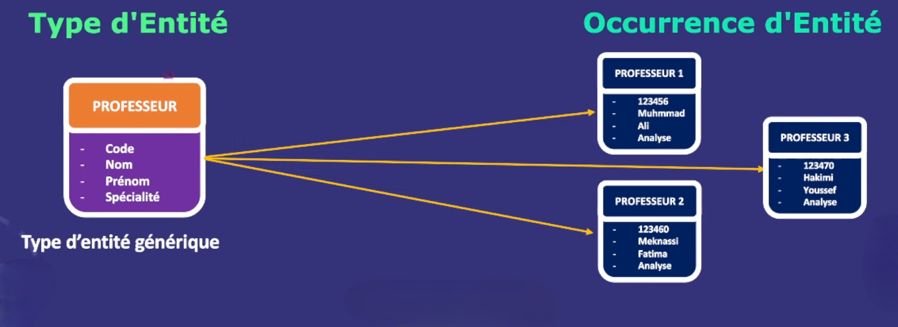</center>

### **Attributes**

- **An attribute (property):** is a characteristic associated with an entity-type or a associations-type.

- **Rule 01:** An attribute cannot be shared by multiple entity-types or associations-types. However, different entities may have properties with the same name, which can be distinguished simply by renaming them.

- **Rule 02:** An attribute is an elementary data item, excluding calculated or derived data.

- **Rule 03:** An entity type and its attributes must be consistent with one another, that is, they should address only a single subject.

### **Value**

- **A value :** Each attribute has a value that is compatible with its domain of definition. The domain of an attribute represents a constraint on the values it may take (integer, character string, date, Boolean, etc.).

- **A domain:** a set of atomic values of one or more attributes.

<center>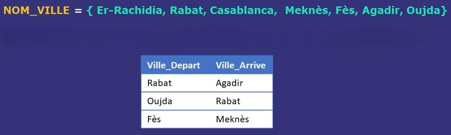</center>

- Two different domains can share the same values while being semantically different.

> - EXample : 
>   - NUM_ELV = {1,2,...,2000}
>   - NUM_ANNE = {1000,1001,...,2100}

> - **Note :** The value domains of attributes are mandatory in the documentation of entity–relationship models but optional in the graphical representation of the model.

- **Rule 01:** When a value domain is represented by a list, two modeling approaches are possible:
    - **Attribute-based modeling:** used for domains with fixed, immutable values that cannot be added or removed, for example, gender = {Male, Female}.
    - **Entity-based modeling:** used for domains with dynamic values that can be added, modified, or deleted, for example, company services.

<center>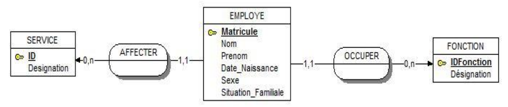</center>

### **Identifier**
- **An identifier :** The attributes that make up an identifier must satisfy three conditions: 
    - Uniqueness of values.
    - The existence of values for all entities.
    - Minimality of the attribute set.

- **A surrogate identifier :** is a non-meaningful attribute used to uniquely identify an entity, mainly to simplify identification, control identifier values, or when no natural attribute set can uniquely identify the entity.

- **Rule 01:** Each entity-type has at least one identifier

### **Association**
- **An association (relationship) :** is a semantic link between multiple entities. The verb used to name an association usually represents the predominant meaning (the entity of primary interest).
- **An association-type (relationship-type) :** refers to a set of relationships that share the same characteristics.

> **Note :**
> - The entity-types involved in an association-type are called the participants of that association-type.
> - The set of participants is called the collection of the association-type.
> - The number of entity-types in this collection is referred to as the dimension, or arity, of the association.
> - A collection contains at least one entity-type but may include several, in which case the association-type is called n-ary.
>
> - Example : 
>   - Binary : has 2 entity-types as participants in the association-type.
>   - Tirnay : has 3 entity-types as participants in the association-type.

- **Rule 01:** An attribute placed in an association-type depends on all the entities linked by that association-type.

- **Rule 02:** An association-type may not have explicit attributes, which is relatively common, but it always has at least implicit attributes. These implicit attributes form its identifier, which is composed of the identifiers of all entities participating in the association.

### **Cardinality**
- The cardinality of a leg connecting an association-type A to an entity-type E specifies the minimum and maximum number of times an entity of type E can participate in an association of type A.

- **Example**
    - An employee works in a minimum of `a` and in a maximum of `b` department(s).

<center>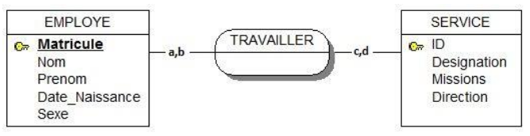</center>

- **Rule 01:** A minimum cardinality is always 0 or 1, and a maximum cardinality is always 1 or n.

> **Note :** 
> - A minimum cardinality of 0 means that an entity-type can be instantiated  independently of its relationship with the association-type.
> - A minimum cardinality of 1 means that an occurrence of the entity-type can exist only if it participates in at least one association of the given association-type.
> - A maximum cardinality of 1 means that an occurrence of the entity-type can participate in an occurrence of the association-type only once.
> - A maximum cardinality of n means that an occurrence of the entity-type can participate an unlimited number of times in associations of the given association-type.

- **Rule 02 :**  
    - In a ternary relationship, all legs normally have a maximum cardinality of n.
    - If one leg has a maximum cardinality of 1, the ternary relationship can be decomposed into two binary relationships.
    - The transformation known as splitting a ternary relationship with maximum cardinality 1.

<center>
    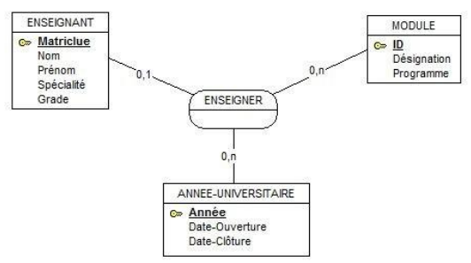
    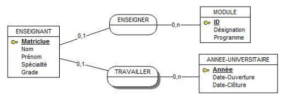
</center>

> #ref : Figure 19 : Eclatement d'une ternaire avec une cardinalité maximale 1

- **Rule 03:** The minimum cardinality must necessarily be 0, since the two associations are semantically independent.

<center>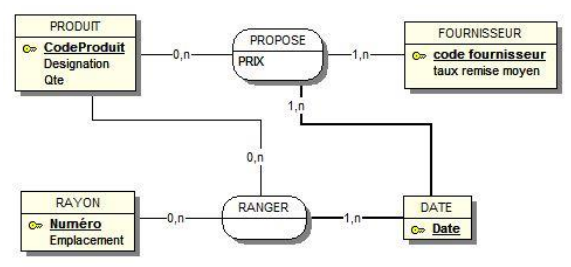</center>

> #ref : Figure 20 : Problème de la cardinalité minimale 1

- **Rule 04:** A 1,1–1,N association-type must not have attributes.

<center>
    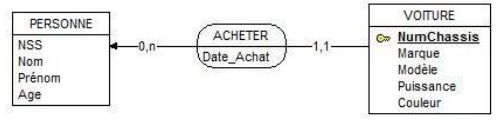
    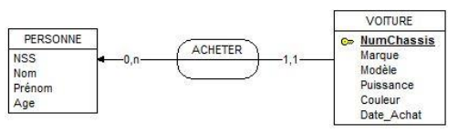
</center>

> #ref : Figure 22 : Association 1.1 ne doit pas avoir d'attributs

### **Graphical Representation**

<center>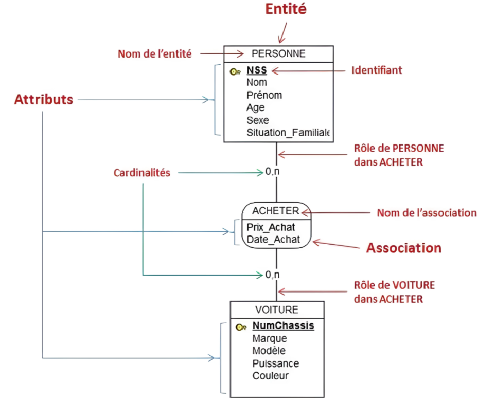</center>

### **Advanced Concepts**

#### **A weak entity**
- **A weak entity :** is an entity whose identifier, by itself, cannot uniquely identify each of its occurrences. Its identifier is valid only within the context of a parent (strong) entity. Therefore, its identifier is composed of two parts: the identifier of the parent entity and an identifier specific to the weak entity.

- **Rule 01:** The cardinality on the weak entity side is always 1,1.

> **Note :**
> - The use of weak entities is not strictly mandatory, since a classical association can also be used. However, a weak entity provides a composite identifier, which is often easier to manage and may simplify certain queries. In contrast, with a classical association, a surrogate identifier must be manually created and subsequently maintained.
> - It is possible to have cascading weak entities. In this case, the identifier of each entity is obtained by migrating the identifiers of the parent entities to the child entities, also in a cascading manner.

<center>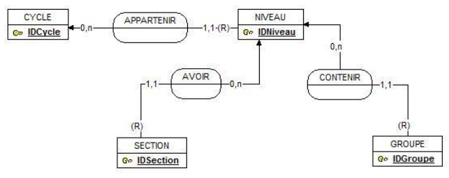</center>

> #ref : Figure 24 : Entités faibles en cascade

#### **Hierarchical Structures**

- **Hierarchical structures :** describe an organization in which a parent entity can have multiple child entities, but each child can be associated with only one parent. They are based on successive parent–child relationships with (1,1) cardinalities on the child side.

- **Rule 01:** Direct relationships between non-adjacent entities are not allowed, in order to strictly maintain the hierarchy.

<center>
    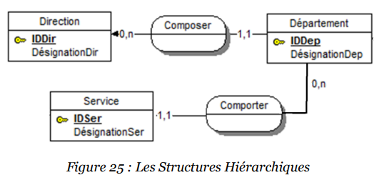
    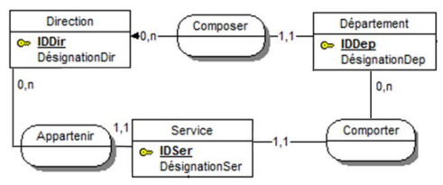
</center>

> #ref : Figure 26 : Structures hiérarchiques avec plusieurs chemins

#### **Plural associations**
- **Plural associations :** are associations that involve the same set of participating entities.

<center>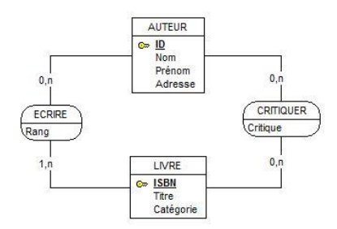</center>

#### **Reflexive relationship**
- **Reflexive relationship:** a association-type is said to be reflexive when it represents a relationship between an entity-type and itself.

<center>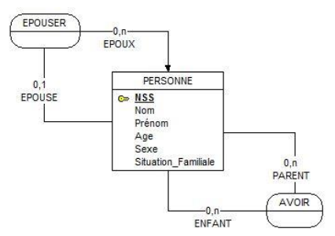</center>

> - **Note :** In the case of a reflexive relationship, the **roles** must be clearly specified on the diagram.

#### **History Preservation**

- An entity-type (e.g., DATE) is added to collection's association-type to prevent instances from being overwritten.

<center>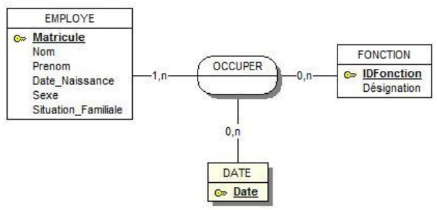</center>

#### **Aggregation**
- **Aggregation :** allows representing situations in which an entity-type is associated with a set of entities-types that are already connected through an association-type.

<center>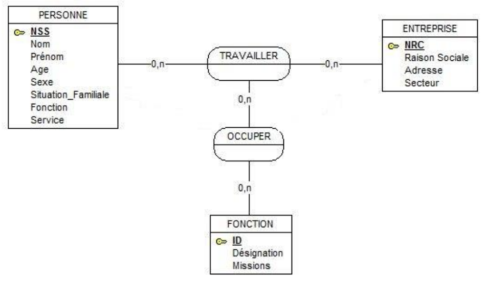</center>

- **Rule 01:** If one leg of an association to be aggregated has a 1,1 cardinality, the aggregation is removed, and all relationships involving that leg are directly linked to the entity on the 1,1 side (the child).

<center>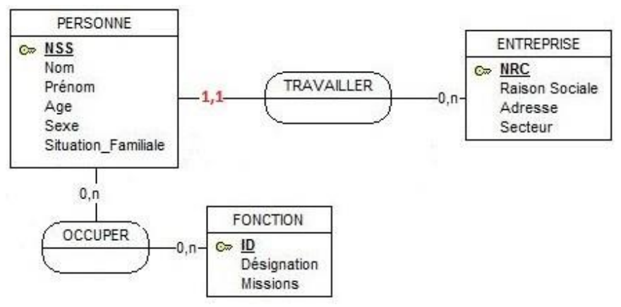</center>

- **Rule 02:** When the minimum cardinality of an **association-type** on the side of the **aggregated association-type** is 1, the aggregation is removed and the situation is modeled using a simple ternary relationship.

<center>
    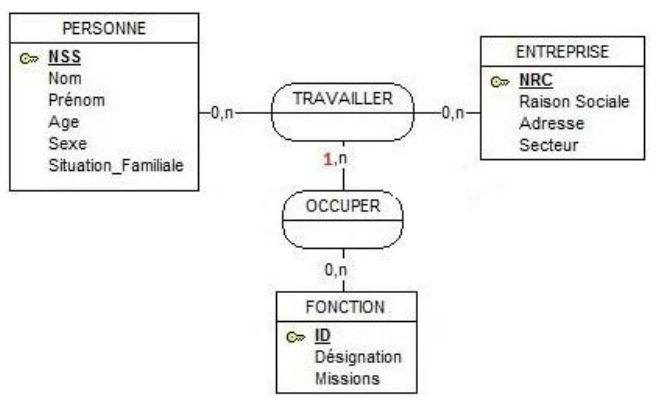
    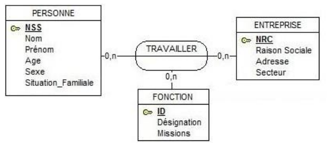
</center>

#### **Inheritance (Generalization/Specialization)**
- **Generalization :** is the process of grouping different entity-types by abstracting their differences and factoring out their common attributes, thereby creating a **generic-entity-type**.

- **Specialization:** is the process of defining subtypes of an entity-type by emphasizing their specific characteristics, whether in terms of attributes or relationships, thereby creating **generated-entity-types**.

- **Rule 01:** 
    - The identifier of **generated-entity-types** is the same as that of the **generic-entity-types**.
    - Therefore, it is not allowed to define another identifier for a **generated-entity-types**.

<center>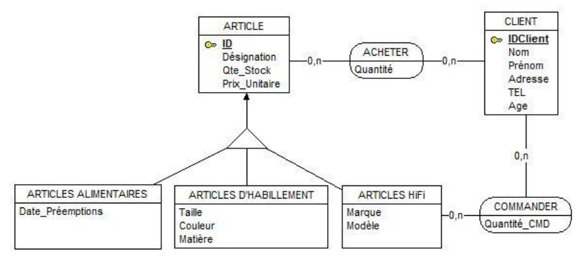</center>

### **Integrity Constraints**

- **An integrity constraint :** is a property that is not represented by the basic concepts of the Entity Association model and that must be satisfied by the **data** stored in the database.

- **Rule 01:** Integrity constraints can be defined on : 
  - Attributes
  - Cardinalities
  - Entities
  - Associations.

#### **Types of Integrity Constraints**
  - **Static constraints :**
    - It must be checked at :
      - Instantiation
      - updating
      - Deletion. 
    - Example : the age must be greater than 18 years.
  - **Dynamic constraints :** 
    - It must be checked during any state change of the model, except at instantiation.
    
    - Example : a married person can only become divorced or widowed, but never single.

#### **Constraints on Attributes' values**
- Domain of Definition.
- Mandatory or Optional Value.
- Constraint on Attribute Values :
    - in relation to a fixed value.
    - in relation to the value of another attribute.
    - Example: 
        - Age between 1 and 100.
        - Date of birth < Date of marriage.

#### **Constraints on Cardinalities**
- Cardinalities themselves are considered constraints.
- A limit can be defined on the maximum number of participants.
    - Example : 
        - It is not *n* but 5.


#### **Constraints on Entities / associations**
- **Rule 01:** 
    - Constraints between two instances (entities/associations) can only be applied if they have the same definition (the same identifier).
    - Therefore, constraints on entities exist only for **generated-entities** from a generalization/specialization.


- **Without-constraints :** Either `one`, the `other`, `both` or `something-else`.

<center>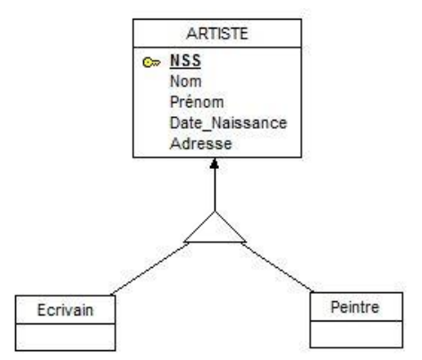</center>


- **Partition :** Either `one` or the `other`, but not both and something-else.

<center>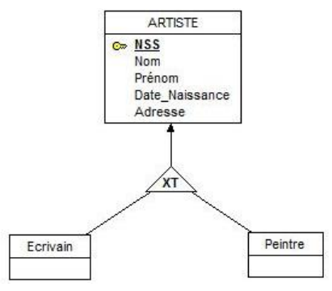</center>


- **Totality :** Either `one` or the `other` or `both`  but not something-else.

<center>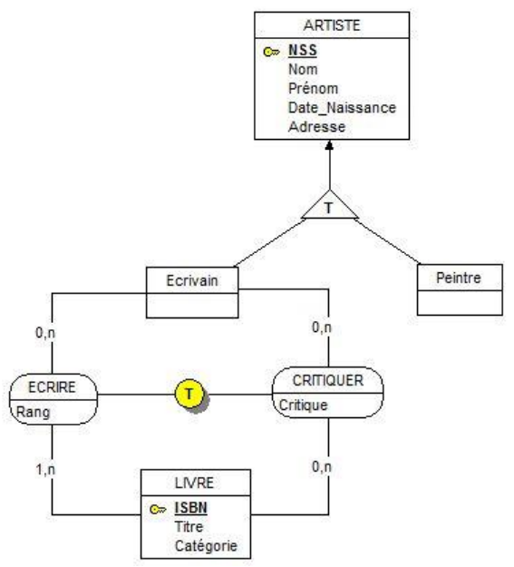</center>


- **Exclusion :** Either `one` or the `other` or `something-else` but not both.

<center>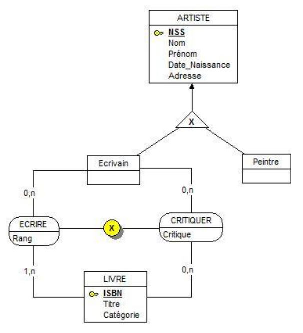</center>

- **Inclusion :** Depending on the orientation, all elements of the first set are included in the second set.

<center>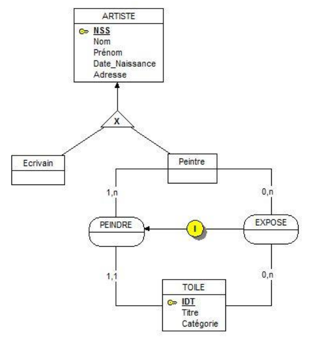</center>

- **Uniqueness (functional dependency or functional integrity constraint):** The constraints will be applied to the association, which will check the uniqueness of the identifiers of its participants.

<center>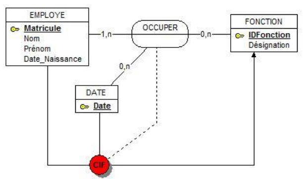</center>


#### **Constraints on partial semilar Associations**
- We want to define a constraint between two associations that share only some entity occurences. these entities must be indicated using dotted lines.

- **Example 01:**

<center>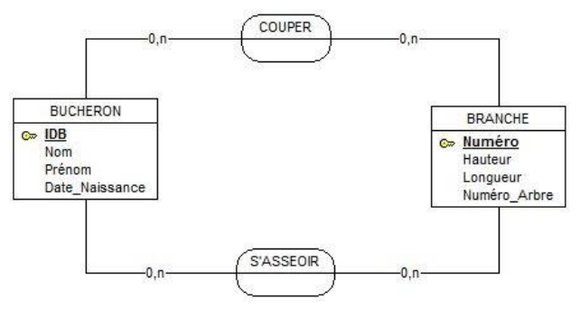</center>

- **First case:** a lumberjack who is sitting is not allowed to cut a branch, and one who is cutting cannot sit.

<center>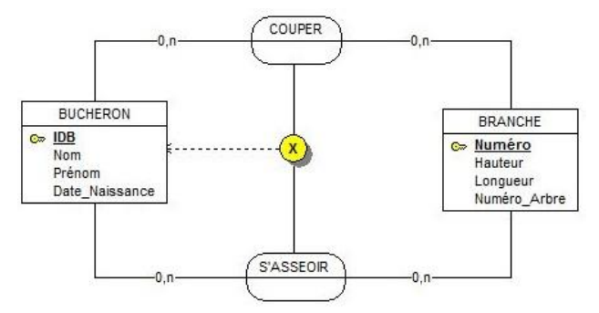</center>

- **Second case:** A branch on which someone is sitting cannot be cut, and a branch that is being cut cannot be sat on.

<center>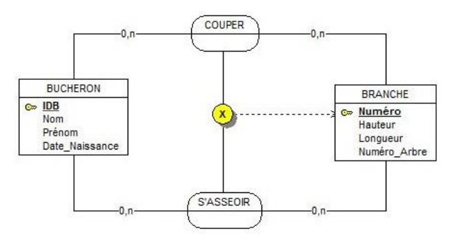</center>

- **Third case:** A lumberjack cannot sit on a branch and saw it at the same time.

<center>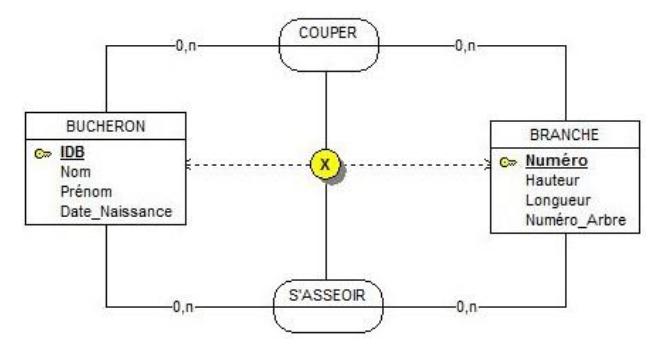</center>

- **Forth case:** a lumberjack who is sitting is not allowed to cut a branch, and a branch on which someone is sitting cannot be cut.

<center>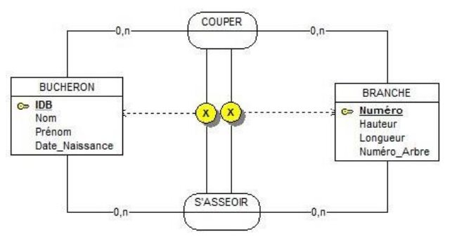</center>

**Example 02:**

This totality constraint ensures that a date occurrence can be a `proposal date`, a `filing date`, or `both` at the same time, but not something-else.

<center>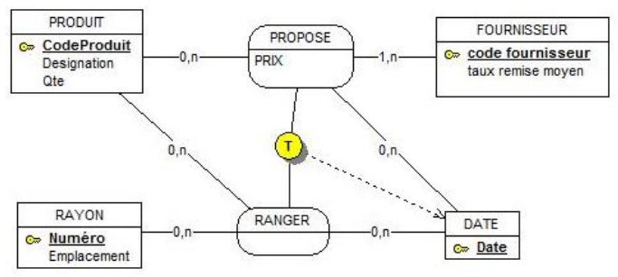</center>


### **Conceptual Schema**

- Entity–Relationship Conceptual Schema = ({Entity-Type}, {Association-Type}, {Integrity Constraints})
- Before submitting it to the developers, the resulting conceptual schema must first be optimized and then validated.

#### **Model Optimization**

- **Rule 01:** The name of an entity-type, association-type, or attribute must be unique. In addition, the same real-world object should not be represented by multiple entity-types, even if they have different names.

<center>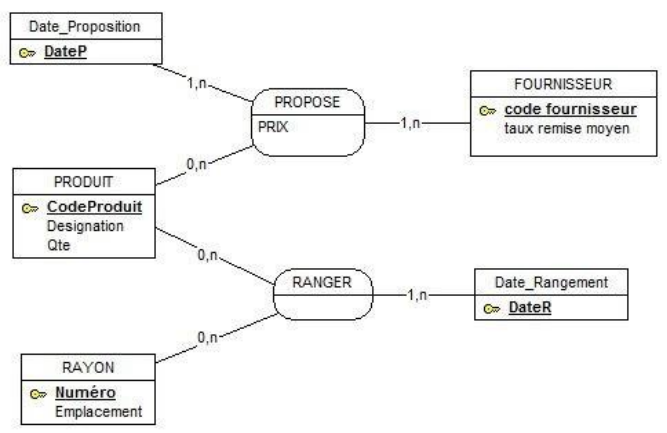</center>

- **Rule 02:** A multivalued attribute should be replaced with a separate entity type.
> Already Seen.

- **Rule 03:** A derived attribute should never be added, whether it is derived from attributes within the same entity-type or from other entity-types.

> Already Seen.

- **Rule 04:** An entity-type must be replaced with an Association-type if :
    - It has an artificial identifier.
    - It is connected to other entities only through (1,1) cardinalities.

<center>
    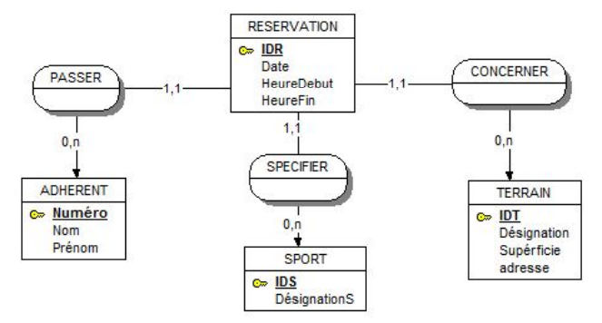
    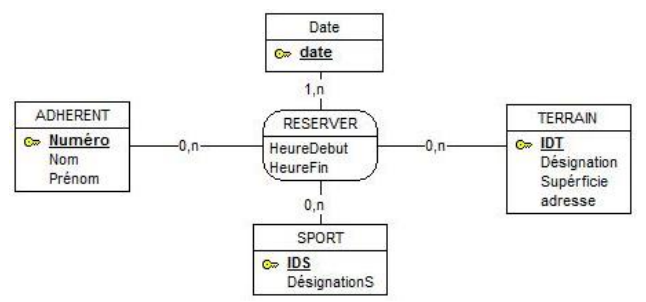
</center>

- **Rule 05:** When all the cardinalities of an association-type are (1,1) :
    - It should be removed.
    - Linked entity types need to be merged into a single entity type.

- **Rule 06:** Redundant Association-types should be avoided. If there are two paths connecting one entity to another, the shorter path should be removed, as it can be inferred from the others.

> Already Seen.

- **Rule 07:** If a ternary relationship has a cardinality of (1,1) or (0,1) on one side, it is split into two separate relationships from that entity.

> Already Seen.

- **Rule 07:**
    - Any n-ary association can be replaced by an entity with an artificial identifier.
    - Creating binary associations between this new entity and each entity from the original n-ary association.
    - The cardinality of each binary relationship is (1,1) on the new entity side and (0,n) or (1,n) on the side of the original entities.

#### **Model Validation**
- Syntactic Verification
- Semantic Verification : 
    - Validation Using a Test Dataset (Seeds).
    - Completeness Check Against Processes (Conceptual Schema Vs User-story).
    - User Validation (useres feedback).

> **Note :** The Entity-association model is a data model, not a process model (dynamic aspects of data, such as triggers).

## **Relational Model**

- It serves as an intermediate step that translates the conceptual EA model into a structure that can be physically implemented in a database using SQL.

### **Terminology**

#### **Domain**
- It is a set of atomic values.

> Already Seen.

#### **Cartesian product**
- The Cartesian product D1 × D2 × … × Dn is the set of all possible tuples (n-tuples).

- **Example :**
    - The domain of colors : D1 = {Blue, White, Red}
    - The domain of vehicle brands : D2 = {Renault, Peugeot, Mercedes}
    - The Cartesian product : D1 × D2 = <br> 
    {(Blue, Renault), (Blue, Peugeot), (Blue, Mercedes), <br>
    (White, Renault), (White, Peugeot), (White, Mercedes), <br>
    (Red, Renault), (Red, Peugeot), (Red, Mercedes)}

#### **Relation**
- It represents a subset of the Cartesian product of the domains defining its attributes
- It is denoted as: R(A1 : D1, …, An : Dn).

- **Example :**
    - Domain of colors: D1 = {Blue, White, Red}
    - Domain of vehicle brands: D2 = {Renault, Peugeot, Mercedes}
    - Resulting relation: Vehicle_Color(Color : D1, Brand : D2)

<center>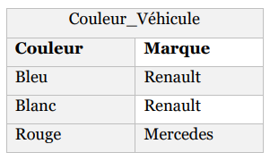</center>

#### **An attribute**
- It is the name given to a column in a relation.

> An image that collect more Terminology
<center></center>
<center>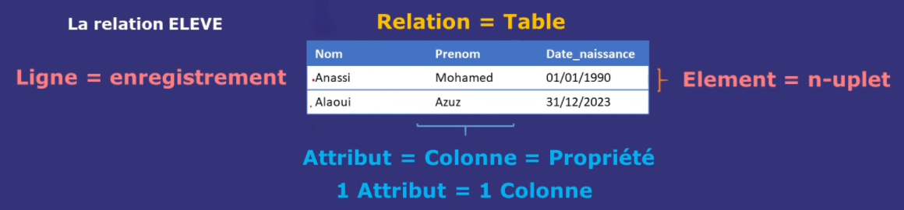</center>


#### **Key of a relation**
- It is a minimal set of attributes that uniquely identifies a tuple within a relation.

#### **The relational schema**

- It is represented by the relation’s name, the list of its attributes with their domains, and the list of its keys.

- **Example :**
    - Car(#Chassis : Text, Model : Text, Year : Integer, Color : Text, Type : Text)

#### **The database's schema**

- It is the set of schemas of all the relations it contains.

#### **A foreign key**
- It is a set of attributes in a relation that matches the primary key of another relation and represents an Association-type in the EA model.

- **Example :**
    - PERSON(#SSN, LAST_NAME, FIRST_NAME)
    - CAR(MODEL, YEAR, COLOR, TYPE, #SSN)
    
    - Referential integrity constraint:
        - CAR.SSN references PERSON.SSN

#### **Referential integrity**
- It is a property ensures foreign keys in a table correctly reference existing primary keys in another table.

- **Insertion case**

<center>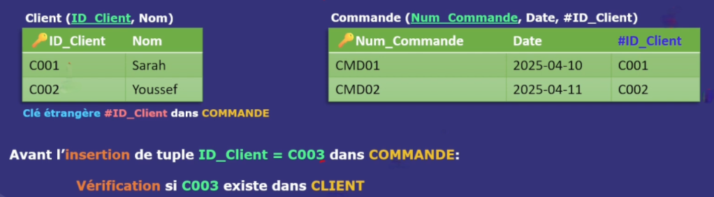</center>

- **Deletion case**

<center>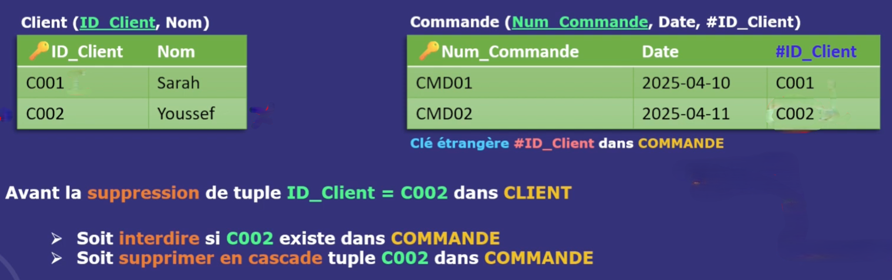</center>

- **Update case**

<center>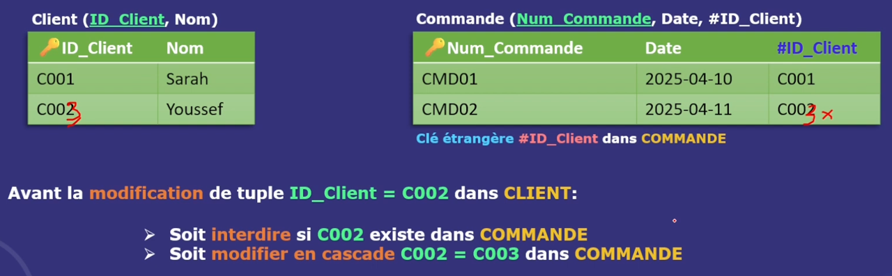</center>

### **Mapping from EA to Relational Model**

- **Rule 1:** Converting a regular (strong) entity to a relational schema
    - Creating a table with the same name as the entity.
    - Adding columns for each of the entity’s attributes.
    - Designating the entity’s primary key as the table’s primary key.

<center>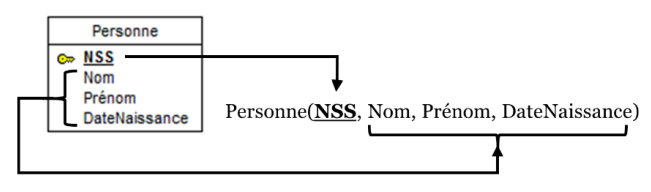</center>

- **Rule 2:** One-to-many (1–n) relationship
    - Adding a foreign key in the table corresponding to the “one” side that references the primary key of the table on the “many” side, and including any association attributes in the same table.


<center>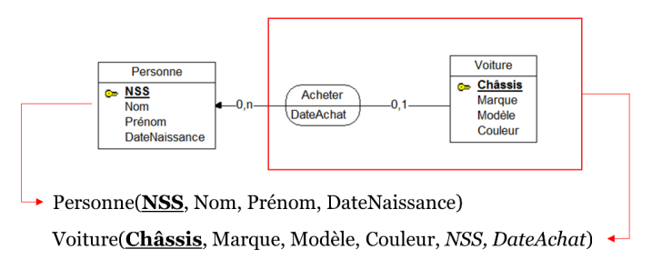</center>

- **Rule 3:** Many-to-many (n–m) relationship
    - creating a new table (junction table) includes:
        - Foreign keys referencing the primary keys of both related tables.
        - Any attributes of the relationship itself.

<center>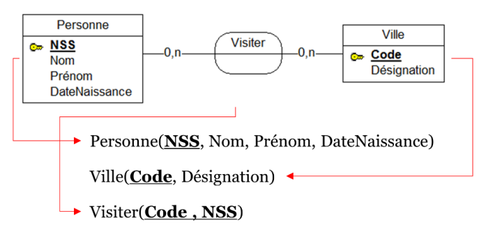</center>

- **Rule 4:** One-to-one (1–1) relationship

- **(0–1)---(1–1) case :**
<center>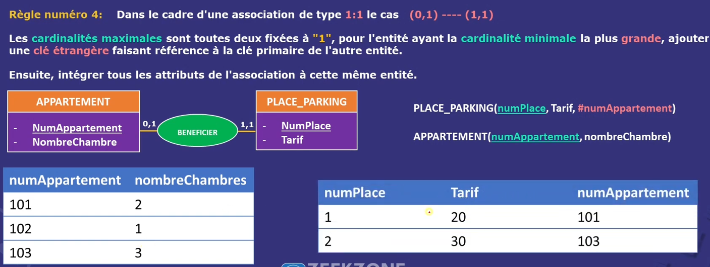</center>

- **(1–1)---(1–1) or (0–1)---(0–1) case :**
    - **Solution 01:**
<center>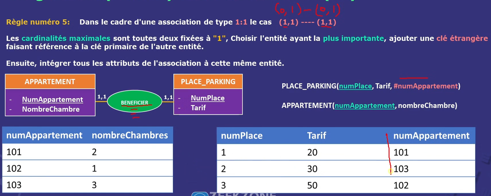</center>
<center>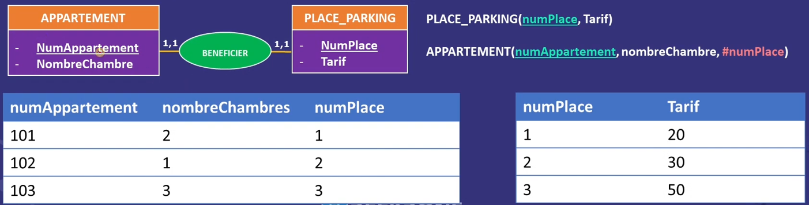</center>

- **Solution 02:**

<center>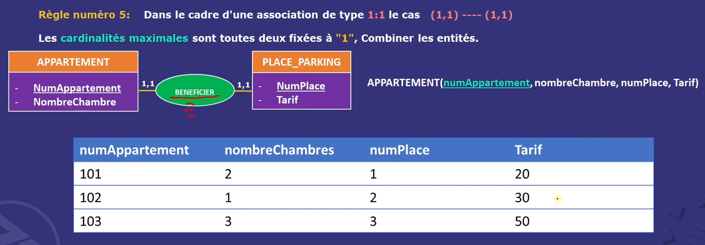</center>
<center>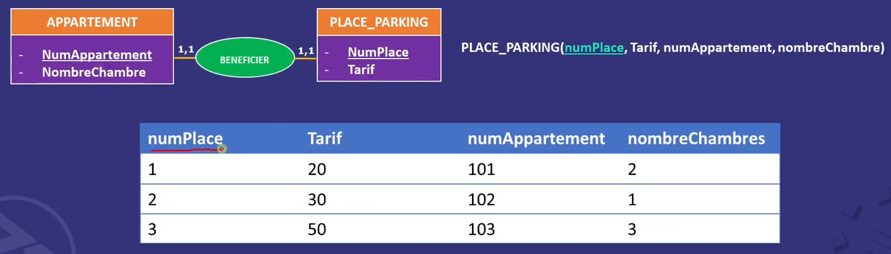</center>

- **Rule 5:** previous relationships but this time with reflexive and ternary associations.

- **Reflexive association : One-to-one (1–1) relationship**

<center>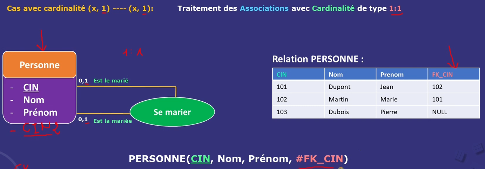</center>

- **Reflexive association : One-to-many (1–n) relationship**

<center></center>

- **Reflexive association : Many-to-many (n–m) relationship**

<center></center>

- **Ternary association : Many-to-many (n–m) relationship**

<center></center>

- **Rule 4:** Weak Entity
    - Creating a table for the weak entity with all its attributes.
    - Including the primary key of the owner (strong) entity as a foreign key (eg : `Chambre.Code` refrence `Hôtel.Code`).
    - Defining the primary key of the weak entity table as the combination of its partial key and the owner’s primary key.

<center></center>

- **Rule 5:** Generalization / Specialization
    - There are three ways to transform a model into a relational schema, and the choice is left to the designer’s judgment.

<center>


</center>

- **Rule 6:** An entity with a single attribute or considered not significant enough may not be stored and is therefore not represented in the relational schema.

<center></center>

### **Normal forms**

#### **First Normal Form (1NF)**
- A relation is in first normal form (1NF) if and only if all its attributes contain atomic values (no multivalued or composite attributes).

- **Counter-example :** 
    - Pers1(nom, prénom, rueEtVille, prénomEnfants) : rueEtVille = composite attributes.
    - Pers1(nom, prénom, rueEtVille, prénomEnfants) : prénomEnfants = list of child (multivalued).

- **1st solution (horizontal storage):** Create as many attributes as the known maximum number of values of the composite attribute.

- **2nd solution (vertical storage):** Create a new relation that includes the key of the original relation and the multivalued attribute, then remove the multivalued attribute from the original relation when the number of values is unknown.

#### **Second Normal Form (2NF)**
- A relation is in second normal form (2NF) if and only if it is in first normal form (1NF) and every non-key attribute depends on the whole of a candidate key, not on just a part of it.

- **Problem & solution :**

<center>


</center>

- **Example :**
    - Problem :
        - Enseignement(NUM, CODEMATIERE, Nom, Volume_horaire) : NUM→Nom
    - Solution : 
        - Enseignement(NUM,CODEMATIERE,Volume_horaire)
        - Enseignant(NUM,Nom)

#### **Third Normal Form (3NF)**
- A relation is in third normal form (3NF) if and only if it is in second normal form (2NF) and no non-key attribute depends on another non-key attribute.

- **Problem & solution :**

<center>


</center>

- **Example :**
    - Problem :
        - Enseignant(Num, Nom, Catégorie, Classe, Salaire) : (Catégorie,Classe)→Salaire
    - Solution : 
        - Enseignement(Num, Nom, Catégorie, Classe)
        - GrilleSalaire(Catégorie, Classe, Salaire)


```python
!jupyter nbconvert --to html MCD_MLD.ipynb
```

    [NbConvertApp] Converting notebook MCD_MLD.ipynb to html
    [NbConvertApp] WARNING | Alternative text is missing on 63 image(s).
    [NbConvertApp] Writing 353669 bytes to MCD_MLD.html
    


```python
!jupyter nbconvert --to markdown MCD_MLD.ipynb
```
